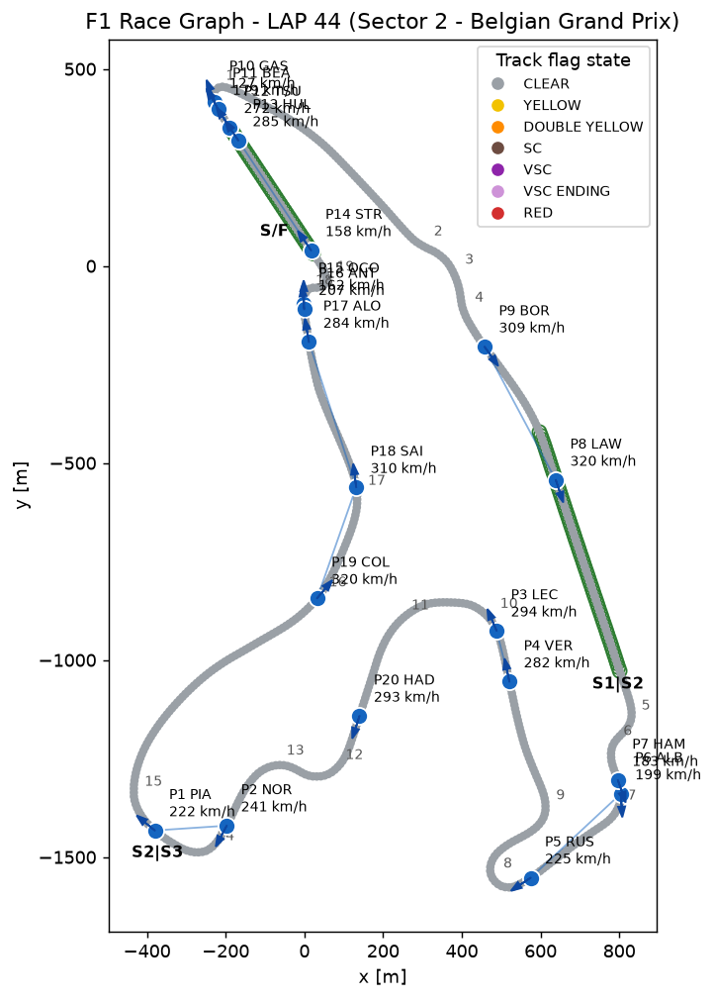
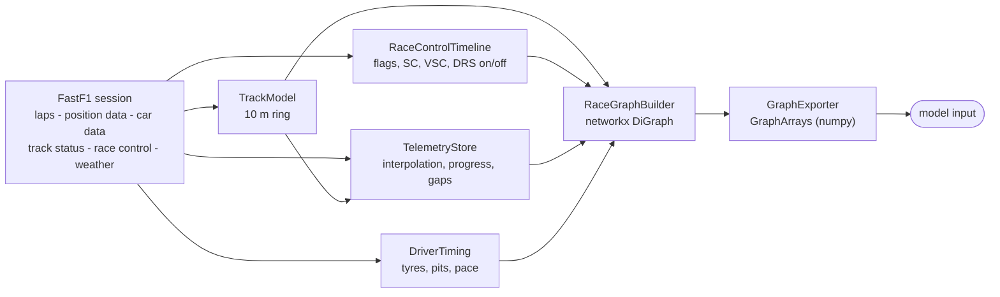
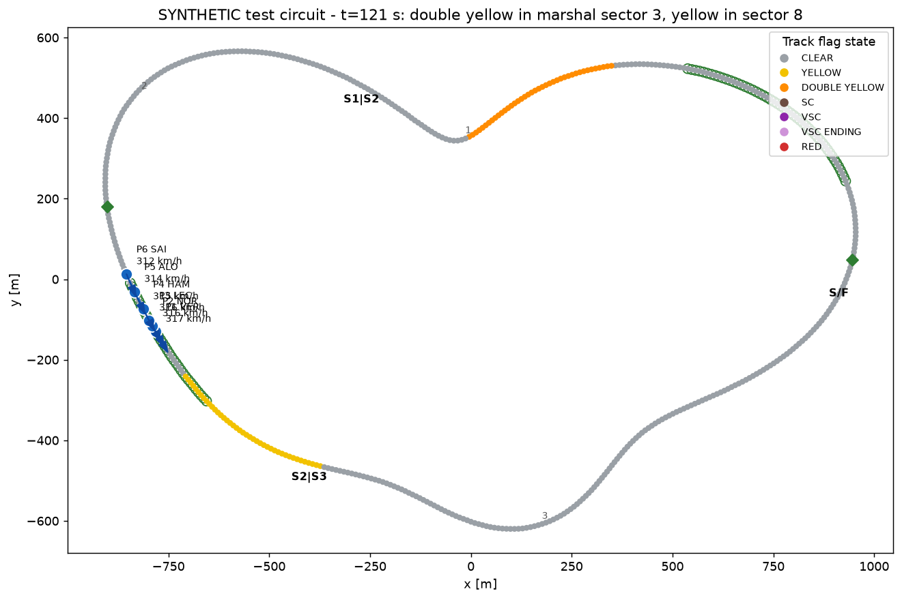

# Formula 1 Strategic Decisions

[](https://github.com/todortoth/Formula-1/actions/workflows/ci.yml)


Turn [FastF1](https://github.com/theOehrly/Fast-F1) race data into **graph snapshots** that a machine-learning
model (the long-term plan is a BERT-style encoder) can learn from: for any moment of a race you get a ring of track
points every ~10 m - carrying geometry, sectors, DRS zones and the current flag state - plus one node per driver
with position, speed, heading, tyres, pit state, pace and true time gaps. The project's goal is to analyse races and
find optimal strategic decisions; this repository is the data foundation for that.

<p align="center">
  <br>
  <em>A real snapshot (2025 Belgian GP, lap 44, the moment the leader crosses the sector 2 line). Grey dots are the
  10 m track nodes, green rings the DRS zones, blue dots cars with their heading, thin lines the proximity edges.</em>
</p>

## Contents

- [Features](#features)
- [Installation](#installation)
- [Quick start](#quick-start)
- [How it works](#how-it-works)
- [The graph schema](#the-graph-schema)
- [Using the graph with a model](#using-the-graph-with-a-model)
- [Command line reference](#command-line-reference)
- [Conventions](#conventions)
- [Limitations and caveats](#limitations-and-caveats)
- [Testing and continuous integration](#testing-and-continuous-integration)
- [Project structure](#project-structure)
- [Migrating from the flat layout](#migrating-from-the-flat-layout)
- [Roadmap](#roadmap)
- [Acknowledgements and disclaimer](#acknowledgements-and-disclaimer)

## Features

- **Track backbone every ~10 m.** A closed centre line rebuilt from a clean reference lap's position telemetry, with
  heading, curvature, gradient, official sectors, corner numbers, marshal sectors and inferred DRS zones per node.
- **Race control per track point.** Green / yellow / double yellow / safety car / VSC / VSC ending / red. Sector
  yellows are placed on exactly the marshal sector they were issued for; SC, VSC and red apply to the whole track.
- **Rich driver nodes.** Position (x, y, z), speed, velocity, heading and heading relative to the track, throttle,
  brake, gear, RPM, DRS, distance from the racing line, tyre compound / age / stint, pit stops, pit-lane state, recent
  pace, classified position.
- **True time gaps.** "How long ago was the car ahead where this car is now", not an approximation from lap ends.
  Lapped traffic is connected by physical proximity.
- **Global context.** Track status, DRS enabled/disabled, safety-car announcements, weather and race progress.
- **Causal snapshots.** The graph at time *t* does not depend on data after *t* (see
  [Snapshots and causality](#snapshots-and-causality)); this is enforced by a test.
- **Model-ready export.** Fixed, named feature schema (one-hot, sin/cos, zero-filled with masks), optional
  normalisation, track pooling to fit a 512-token limit, token-type / position ids.
- **Degrades gracefully** when FastF1 lacks circuit info, sector times, DRS data, weather or race-control messages.

## Installation

Requires Python 3.10 or newer.

```bash
git clone https://github.com/todortoth/Formula-1.git
cd Formula-1
python -m venv .venv
source .venv/bin/activate          # Windows: .venv\Scripts\activate
pip install -e .                   # runtime only
pip install -e ".[dev]"            # plus pytest, coverage, hypothesis, ruff, build
```

FastF1 downloads data from F1's live-timing servers on first use and caches it (default `~/fastf1_cache`, override
with `--cache-dir` or the `F1_CACHE_DIR` environment variable). A full race with telemetry is a large download.

## Quick start

### Command line

```bash
python main.py                                     # 2025 Belgian GP, race, lap 44 (the original example)
f1-graph --year 2024 --event Monza --lap 30        # same as: python -m f1strategy ...
f1-graph --lap 10 --sectors "Sector 2" --no-tables
```

For each requested sector it prints the lap tables, builds the graph at the moment the **leader** crosses that sector
line, saves a plot (`graphs/graph_sector2.png`) and the model arrays (`graphs/graph_lap44_sector2.npz`).
All options are listed in the [command line reference](#command-line-reference).

### Python

```python
from f1strategy import GraphExporter, SessionAnalyser, suggest_pool_factor

analyser = SessionAnalyser(2025, "Belgian Grand Prix", "R")    # downloads / loads from cache
print(analyser.track)                                          # e.g. TrackModel(695 nodes, length=6947 m, ...)

# 1) a snapshot when the leader of lap 44 crosses the sector 2 line
G = analyser.build_session_graph(target_lap=44, sector_name="Sector 2")

# ... or at any session time (seconds since the start of the data stream)
G = analyser.build_graph_at_time(3600.0)

G.nodes["T0042"]["flag_label"]       # 'CLEAR' | 'YELLOW' | 'DOUBLE YELLOW' | 'SC' | 'VSC' | 'VSC ENDING' | 'RED'
G.nodes["VER"]["speed_kmh"]          # driver nodes are keyed by their 3 letter code
G.graph["global"]["is_sc"]           # graph-level context

# 2) model-ready arrays
arrays = GraphExporter(normalise=True).export(G)
arrays = arrays.pool_track(suggest_pool_factor(len(arrays.track_x), len(arrays.driver_codes)))
arrays.track_x.shape, arrays.driver_x.shape, arrays.global_x.shape
```

A dataset is just many snapshots with an identical schema:

```python
import numpy as np

times = np.arange(600.0, 5400.0, 5.0)                       # every 5 s
snapshots = [GraphExporter(normalise=True).export(analyser.build_graph_at_time(t)).pool_track(2) for t in times]
np.savez_compressed("race.npz", track_x=np.stack([s.track_x for s in snapshots]),
                    driver_x=np.stack([s.driver_x for s in snapshots]),
                    global_x=np.stack([s.global_x for s in snapshots]))
```

The first snapshot of a session is slower: every driver's progress curve over the whole race is computed once and
cached.

## How it works



`SessionAnalyser` is the facade: it loads the session, builds the four components and exposes
`build_session_graph` / `build_graph_at_time`.

### Track model

FastF1 has no track outline, so it is rebuilt from the position telemetry of the fastest *clean* lap (timed, accurate,
no pit in/out lap, not lap 1, preferably green flag only). The lap is closed and resampled by arc length into
`round(length / 10 m)` nodes, so the real spacing is `length / n`, i.e. 10 m +- ~0.5 %. Node 0 sits on the
start/finish line. Heading and curvature come from a lightly smoothed (~12 m) copy of the line; node positions stay raw.

| Layer | Source |
|---|---|
| Official sectors S1 / S2 / S3 | The reference lap's `Sector1SessionTime` / `Sector2SessionTime` projected onto the line (equal thirds as a fallback, with a warning). |
| Corner numbers | `session.get_circuit_info().corners` projected onto the line. |
| Marshal sectors | `session.get_circuit_info().marshal_sectors`; each marker is taken as the *start* of its sector, and the nodes before the first marker wrap to the last sector. |
| DRS zones | Inferred from where any car had the DRS channel open (10, 12, 14) across the whole session: busy nodes are merged into zones of at least 100 m. |
| DRS detection points | Not available from the API - see [Limitations](#limitations-and-caveats). |

If circuit info cannot be fetched, corners and marshal sectors stay unknown (`-1`) and sector-specific yellows cannot be
placed on the track, but the global flag state is still reported.

### Race control and flags

Two feeds are combined by `RaceControlTimeline`:

| Feed | Provides |
|---|---|
| `session.track_status` | Global state: `1` clear, `2` yellow (sectors unknown), `4` safety car, `5` red, `6` VSC, `7` VSC ending. |
| `session.race_control_messages` | Per-marshal-sector yellow / double yellow / clear, "TRACK CLEAR", DRS enabled / disabled, "SAFETY CAR IN THIS LAP". |

Replay rules: status `1` clears every sector flag; a sector message sets or clears that sector; `TRACK CLEAR` clears all;
at the same instant, status events are applied before messages. The state at any time is a bisect lookup.
Per track node the builder derives `flag_yellow` / `flag_double_yellow` from the node's marshal sector and
`flag_sc` / `flag_vsc` / `flag_vsc_ending` / `flag_red` from the global status, plus a single `flag_label` for plotting
(priority: RED > SC > VSC ENDING > VSC > DOUBLE YELLOW > YELLOW > CLEAR).

<p align="center">
  <br>
  <em>Synthetic test circuit (not a real track): a double yellow in marshal sector 3 and a yellow in sector 8 colour only
  their own stretch of track.</em>
</p>

> Note: an earlier version of `SectorNode` treated status `"7"` as the red flag. In FastF1 `"5"` is red and `"7"` is
> VSC ending; this is fixed and covered by a regression test.

### Driver state

`TelemetryStore` makes the telemetry random-access. Position (~220 ms) and car data (~240 ms) are on different clocks,
so both are interpolated (linearly for continuous channels, nearest sample for gear / brake / DRS). Each car is then
projected onto the track, which gives its exact distance along the lap and offset from the racing line.

*Progress* is the unwrapped cumulative distance, anchored so that it is 0 at the start/finish line at lights-out
(grid slots are slightly negative, formation laps do not matter). From the progress curves the true time gap follows:
the time at which the car ahead was at the progress where the car behind is now.

`DriverTiming` adds tyre compound / age / stint, pit-lane entries and pit-lane state, the mean of the last three
representative laps (no in/out laps, none with SC / VSC / red), and the classified position.

### Snapshots and causality

`build_graph_at_time(t)` returns the graph of the whole race at session time `t`. `build_session_graph(lap, sector)`
chooses `t` as the moment the **leader** of that lap crosses the sector line (or the lap start without a sector).

A snapshot only uses information available at `t`: lap times of laps that have not finished are not used, pit stops are
a count of entries so far, DRS is "disabled" until a message enables it. `tests/integration/test_causality.py` builds each
graph twice - from the full session and from one with everything after `t + 2 s` deleted - and requires identical
results. Exceptions, stated honestly:

- Interpolation and velocity use the neighbouring samples, i.e. at most ~0.3 s beyond `t`.
- The track layout and the DRS zones are static properties derived from the whole session.
- `finished_or_retired` depends on the final lap timestamp of a driver; it is never true before that time + 5 s.

## The graph schema

The graph is a `networkx.DiGraph`. Every relation is stored in both directions so message passing works.

**Nodes**

| Type | Id | Count |
|---|---|---|
| `track` | `"T0000"` ... | one per ~10 m of circuit (ring) |
| `driver` | 3 letter code, e.g. `"VER"` | one per car |

**Edges**

| `edge_type` | Between | Attributes |
|---|---|---|
| `track_next` / `track_prev` | consecutive track nodes (ring) | `length_m` |
| `on_node` / `occupied_by` | driver <-> its nearest track node | `offset_m` (along the track from the node), `lateral_m` |
| `proximity` | driver <-> driver | see the edge table below; created when the time gap is at most 5 s **or** the cars are within 50 m on the track (catches lapped traffic) |

**Graph attributes** (`G.graph`): `time_s`, `global` (dict, below), `track` (the `TrackModel`), `driver_codes`,
`driver_nodes` (`DriverNode` objects, ordered by race position), `race_control` (a `RaceControlState`: status, sector flags, DRS), `event`.

The tables below are the **exported feature schema** (`GraphExporter`); the same names exist as node / edge attributes
on the graph, except the derived ones (one-hots, sin/cos). They are checked against the code by a test.

### Track node features

<!-- BEGIN:track-features -->
| Feature | Meaning |
|---|---|
| `s_m` | Distance from the start/finish line along the lap, in metres. |
| `x_m` | World x of the node (frame of the FastF1 position feed), metres. |
| `y_m` | World y of the node, metres. |
| `z_m` | Elevation of the node, metres. |
| `heading_sin` | Direction of the track tangent, `sin(atan2(dy, dx))`. |
| `heading_cos` | Direction of the track tangent, `cos(atan2(dy, dx))`. |
| `curvature` | Signed curvature in 1/m, positive = left turn (from a ~12 m smoothed centre line). |
| `gradient` | Slope `dz/ds` (metre per metre). |
| `sector_1` | One-hot official timing sector 1 (boundaries come from the reference lap's sector times). |
| `sector_2` | One-hot official timing sector 2. |
| `sector_3` | One-hot official timing sector 3. |
| `is_corner` | 1 on the node closest to a numbered corner marker. |
| `corner_number` | Corner number of that marker (0 = none). |
| `marshal_sector` | Marshal sector the node lies in (-1 = unknown) - the unit in which sector yellow flags are issued. |
| `in_drs_zone` | Node is inside an inferred DRS activation zone. |
| `is_drs_start` | First node of a DRS zone (the activation line). |
| `is_drs_end` | Last node of a DRS zone. |
| `is_drs_detection` | Nearest node to a DRS detection point (only when you supply them, see Limitations). |
| `flag_yellow` | Yellow flag in this node's marshal sector. |
| `flag_double_yellow` | Double yellow in this node's marshal sector. |
| `flag_sc` | Safety car deployed (applies to every node). |
| `flag_vsc` | Virtual safety car deployed (every node). |
| `flag_vsc_ending` | VSC ending (every node). |
| `flag_red` | Red flag (every node). |
| `n_drivers` | Number of cars whose nearest track node is this one. |
<!-- END:track-features -->

### Driver node features

<!-- BEGIN:driver-features -->
| Feature | Meaning |
|---|---|
| `x_m` | Car position at the snapshot time (interpolated), metres. |
| `y_m` | Car position y, metres. |
| `z_m` | Car elevation, metres. |
| `speed_kmh` | Speed from the car data channel, interpolated. |
| `vx_mps` | Velocity x from the position feed (central difference over +-0.3 s), m/s. |
| `vy_mps` | Velocity y, m/s. |
| `heading_sin` | Direction of travel `sin(atan2(vy, vx))`; below 2 m/s the track tangent is used instead. |
| `heading_cos` | Direction of travel, cosine. |
| `heading_rel_track_sin` | Heading relative to the track tangent, sine (about 0 when aligned; large when spinning or in the pit lane). |
| `heading_rel_track_cos` | Heading relative to the track tangent, cosine. |
| `throttle` | Throttle in percent. |
| `brake` | Brake on (0/1). |
| `gear` | Gear. |
| `rpm` | Engine revs. |
| `drs_open` | DRS flap open (raw DRS channel 10, 12 or 14). |
| `drs_eligible` | Raw DRS channel equals 8 ("detected / eligible"; semantics are not officially documented). |
| `track_s_m` | Distance from the start/finish line of the car's projection onto the centre line, metres. |
| `lap_fraction` | `track_s_m` divided by the track length. |
| `lateral_offset_m` | Signed distance from the reference line, metres (+ = left). |
| `progress_m` | Cumulative race distance (laps x length + position); 0 at the line at lights-out, grid slots are slightly negative. |
| `lap_number` | Lap the car is on, from the timing table. |
| `position` | Live race position, ranked by `progress_m`. |
| `official_position` | Classified position at the end of the car's last completed lap (NaN before the first). |
| `gap_to_leader_s` | True time gap to the leader: how long ago was the leader where this car is now. |
| `gap_ahead_s` | Same, to the car directly ahead (NaN for the leader). |
| `gap_behind_s` | Same, of the car directly behind to this car (NaN for the last car). |
| `tyre_age` | Laps on the current set (FastF1 `TyreLife`). |
| `fresh_tyre` | Current set was new when fitted. |
| `stint` | Stint number. |
| `pit_stops` | Pit lane entries so far (a pure count of entries up to the snapshot time). |
| `in_pit` | Car is in the pit lane right now (between pit entry and the next lap's pit exit). |
| `on_track` | Position feed status is not `OffTrack`. |
| `pace_last3_s` | Mean of the last three completed representative laps (no in/out laps, none with SC/VSC/red), seconds. |
| `last_lap_time_s` | Time of the last completed lap, seconds. |
| `finished_or_retired` | More than 5 s have passed since the car's final lap timestamp. |
| `compound_soft` | One-hot: current tyre compound is SOFT. |
| `compound_medium` | One-hot: current tyre compound is MEDIUM. |
| `compound_hard` | One-hot: current tyre compound is HARD. |
| `compound_intermediate` | One-hot: current tyre compound is INTERMEDIATE. |
| `compound_wet` | One-hot: current tyre compound is WET. |
| `compound_unknown` | One-hot: compound unknown / not in the list above. |
<!-- END:driver-features -->

### Global features

<!-- BEGIN:global-features -->
| Feature | Meaning |
|---|---|
| `time_s` | Snapshot time in session seconds. |
| `leader_lap` | Lap of the race leader. |
| `laps_remaining` | Scheduled laps minus leader lap (NaN if unknown). |
| `race_fraction` | Leader lap divided by scheduled laps. |
| `is_green` | No flag anywhere: track status clear and no sector flags. |
| `is_yellow` | Yellow somewhere: track status yellow or any sector flagged. |
| `is_sc` | Safety car deployed. |
| `is_vsc` | Virtual safety car deployed. |
| `is_vsc_ending` | VSC ending. |
| `is_red` | Red flag. |
| `sc_in_this_lap` | Race control announced "SAFETY CAR IN THIS LAP" (reset at all-clear). |
| `yellow_unlocalised` | Track status says yellow but no marshal sector is known (messages missing). |
| `n_yellow_sectors` | Number of marshal sectors currently under yellow / double yellow. |
| `drs_enabled` | Race control has enabled DRS. Disabled until the first enabling message; unknown (masked) if there is no message feed at all. |
| `air_temp` | Air temperature, deg C. |
| `track_temp` | Track temperature, deg C. |
| `humidity` | Relative humidity, percent. |
| `pressure` | Air pressure, mbar. |
| `rainfall` | Rain (0/1). |
| `wind_speed` | Wind speed, m/s. |
| `wind_direction_sin` | Wind direction, sine. |
| `wind_direction_cos` | Wind direction, cosine. |
| `n_drivers` | Number of cars in the snapshot. |
<!-- END:global-features -->

### Proximity edge features

<!-- BEGIN:edge-features -->
| Feature | Meaning |
|---|---|
| `gap_s` | Time gap seen from the source car; **positive = the target is ahead**. NaN when undefined (e.g. a lap apart, never reached that point). |
| `progress_gap_m` | Difference in cumulative race distance, target minus source, metres. |
| `circular_gap_m` | Shortest signed distance along the track ignoring laps, in (-L/2, L/2]; this is what connects lapped traffic. |
| `lap_diff` | Whole laps the target is ahead of the source (negative = behind). |
| `rel_speed_kmh` | Target speed minus source speed. |
| `order_neighbor` | The two cars are consecutive in the running order. |
| `drs_window` | Source is the follower, within 1.0 s of the target and on the same lap (approximates the DRS rule with the true gap). |
<!-- END:edge-features -->

## Using the graph with a model

`GraphExporter.export(G)` returns a `GraphArrays` with, per snapshot:

| Array | Shape | Content |
|---|---|---|
| `track_x`, `track_mask` | `[N, F_track]` | track node features; mask `True` = value present |
| `driver_x`, `driver_mask` | `[D, F_driver]` | driver features, ordered by race position |
| `global_x`, `global_mask` | `[1, F_global]` | global features |
| `track_edge_index` | `[2, 2N]` | the ring, both directions |
| `driver_to_track` | `[D]` | track node (token) of every driver |
| `driver_edge_index`, `driver_edge_attr` | `[2, E]`, `[E, F_edge]` | proximity edges |

Categorical values are one-hot (compound, sector), angles are sin/cos, missing values are `0` with a mask (never NaN).
`GraphExporter(normalise=True)` rescales with rough physical constants (x / y by the track's bounding box, progress by
the race distance); for real training, compute statistics on your training set instead. `GraphArrays.validate()`
checks internal consistency and runs automatically after export and pooling. `to_dict()` is ready for
`np.savez_compressed`, `to_torch()` returns tensors if PyTorch is installed.

### BERT token budget

A BERT encoder has 512 positions. One token per driver plus a global token plus one per track node does not fit: at
10 m, Spa has 695 track nodes. `pool_track(factor)` merges neighbouring nodes (flags, DRS and corner markers use *max*
so no event is lost, continuous features use the mean, `n_drivers` is summed) and
`suggest_pool_factor(n_track, n_drivers, max_tokens=512)` picks the smallest factor that fits (2 for Spa with 20
drivers). `token_layout()` returns `token_type_ids` (0 global, 1 driver, 2 track) and per-type `position_ids`.

The three token types have different feature widths, so the model needs one linear projection per type plus a
token-type embedding, then feeds `inputs_embeds` to the encoder. A sketch (not part of the package and not run in this
repository's tests - adapt it freely):

```python
import torch
import torch.nn as nn
from transformers import BertConfig, BertModel


class RaceGraphEncoder(nn.Module):
    def __init__(self, n_global, n_driver, n_track, hidden=256):
        super().__init__()
        cfg = BertConfig(hidden_size=hidden, num_hidden_layers=4, num_attention_heads=4,
                         intermediate_size=4 * hidden, max_position_embeddings=512, type_vocab_size=3)
        self.bert = BertModel(cfg, add_pooling_layer=False)
        self.proj = nn.ModuleList([nn.Linear(n_global, hidden), nn.Linear(n_driver, hidden), nn.Linear(n_track, hidden)])

    def forward(self, g, d, t, token_type_ids, position_ids):          # g [B,1,Fg]  d [B,D,Fd]  t [B,N,Ft]
        x = torch.cat([self.proj[0](g), self.proj[1](d), self.proj[2](t)], dim=1)
        return self.bert(inputs_embeds=x, token_type_ids=token_type_ids, position_ids=position_ids).last_hidden_state
```

Not included yet: an attention mask encoding the ring / driver-to-track structure, and training targets (see
[Roadmap](#roadmap)).

## Command line reference

`python main.py`, `python -m f1strategy` and `f1-graph` are equivalent.

<!-- BEGIN:cli-options -->
| Option | Default | Meaning |
|---|---|---|
| `--year` | 2025 | Season. |
| `--event` | `Belgian Grand Prix` | Event name (fuzzy-matched by FastF1) or, if all digits, the round number. |
| `--session` | `R` | Session identifier: `R`, `Q`, `S`, `SQ`, `FP1`... |
| `--lap` | 44 | Lap whose sector crossings define the snapshots (taken when the **leader** crosses the sector line). |
| `--sectors` | all three | Any of `"Sector 1"` `"Sector 2"` `"Sector 3"`. |
| `--out-dir` | `graphs` | Where PNGs and `.npz` files go. |
| `--spacing` | 10 | Track node spacing in metres. |
| `--max-tokens` | 512 | Token budget used to choose the track pooling factor. |
| `--drs-detection-offset` | none | Estimate DRS detection points as *zone start minus this many metres*. |
| `--cache-dir` | `$F1_CACHE_DIR` or `~/fastf1_cache` | FastF1 cache directory. |
| `--no-tables` | off | Skip the console tables. |
| `--no-plots` | off | Skip the PNG plots. |
| `--no-export` | off | Skip the `.npz` export. |
| `--verbose` | off | Debug logging (`-v`). |
<!-- END:cli-options -->

## Conventions

- **Units.** Metres, km/h (speed) and m/s (velocity), radians, seconds. FastF1 positions are in 1/10 m and are converted
  on the way in.
- **Session time.** Seconds since the start of the data stream (FastF1 `SessionTime`), *not* since the race start.
- **Angles** are `atan2(dy, dx)` in the position feed's frame; `curvature > 0` is a left turn.
- **Ids.** Track nodes `T0000`..., drivers by their 3 letter code.

## Limitations and caveats

- **DRS detection points are not in any F1 data feed.** Pass them yourself (`drs_detection_points_m=[...]`, metres from
  the start/finish line) or estimate them (`drs_detection_offset_m`: zone start minus an offset). The nearest 10 m node is
  flagged `is_drs_detection`, so it is within 5 m of the exact point. DRS activation zones themselves *are* inferred
  from telemetry.
- **Marshal sector markers** are assumed to mark the *start* of each sector. If sector flags look shifted on a real
  circuit, this is the assumption to check.
- **DRS channel semantics.** Values 10, 12, 14 are treated as "open" and 8 as "eligible"; FastF1 documents these as
  needing more research. `drs_window` approximates the 1 s rule with the true gap, not with the timing at the detection point.
- **Pit lane** is not modelled geometrically: a car in the pit lane is projected to the nearest main-track node; use
  `in_pit`.
- **One outline per session** - taken from one lap, so temporary track changes within a session are not represented.
- **Not included yet:** per-driver blue flags, penalties, forecasts, anything outside the FastF1 feeds.
- **Minimum versions.** The declared lower bounds (numpy 1.24, pandas 2.0, scipy 1.10, networkx 3.0, matplotlib 3.7,
  FastF1 3.4) are exercised by CI, but with FastF1 itself mocked: they show the code works with those versions, not that
  FastF1 3.4's live API behaves identically. Development and the real Spa run used a current FastF1.
- **Data quality is FastF1's.** Missing drivers, missing telemetry and all-zero position samples are handled (zero
  samples are dropped), but wrong source data stays wrong.
- **FastF1 versions.** `fastf1>=3.4` is declared; the API surface used was inspected against FastF1 3.8.3 and the real
  run used a current release. The offline tests inject the session instead of importing FastF1, so older FastF1
  releases are only checked at install level.
- **Verification status.** The logic is covered by several hundred tests on a synthetic session with known ground truth.
  The full pipeline has been run on real data for the 2025 Belgian Grand Prix (695 nodes, 20 drivers). Other circuits and
  seasons are expected to work but have not been checked individually - the [live tests](#live-tests) are meant to grow
  that coverage.

## Testing and continuous integration

```bash
pip install -e ".[dev]"
python -m pytest                           # offline tests (default)
python -m pytest --cov                     # with coverage
python -m pytest -m live tests/live        # live tests against the real API (network, slow)
ruff check . && ruff format --check .      # lint + format
```

### Test tiers

| Tier | Where | What |
|---|---|---|
| Unit | `tests/unit` | One module at a time: geometry on analytic shapes (a circle has a known curvature), race-control replay, telemetry interpolation, anchoring, timing, exporter, plotting, CLI helpers. Includes property-based tests (hypothesis). |
| Integration | `tests/integration` | End to end: dataset assembly, determinism, **causality**, CLI. |
| Live | `tests/live` | The real FastF1 API on the 2025 Belgian GP. Deselected by default. |

All offline tests run against `tests/synthetic/session.py`: a synthetic session that mimics FastF1's structure (column
names, units, dtypes, quirks such as all-zero position samples and the separate clocks) around a circuit with *exactly
known* geometry, positions, gaps, flags, a pit stop, a retirement, an SC, a VSC and DRS windows. Each data source can be
switched off to test degraded input. Warnings are treated as errors.

### Live tests

They need network access to F1's servers and download hundreds of MB on first use, so they run in a separate scheduled
workflow rather than on every push. Their reference values come from a real run on the 2025 Belgian GP.

### GitHub Actions

| Workflow | Trigger | Does |
|---|---|---|
| `ci.yml` | push to `master`/`main`, pull requests | lint + format check; tests on Python 3.10-3.13 (Linux) and 3.12 (Windows) with a 95 % coverage gate; tests against the *minimum* supported dependency versions; package build + install of the wheel. |
| `live-data.yml` | weekly, manual | the live tests, with the FastF1 cache cached between runs. |

## Project structure

<!-- BEGIN:project-structure -->
```
Formula-1/
├── main.py                       launcher: python main.py (works without installing)
├── pyproject.toml                packaging, dependencies, pytest / ruff / coverage config
├── src/f1strategy/
│   ├── __init__.py               public API, __version__
│   ├── __main__.py               python -m f1strategy
│   ├── cli.py                    command line interface
│   ├── session.py                SessionAnalyser: loads the session, builds components, facade
│   ├── plotting.py               track map of a race graph
│   ├── reporting.py              console tables
│   ├── utils.py                  units, position cleaning, circular runs, time formatting
│   ├── domain/
│   │   ├── driver.py             DriverNode
│   │   └── sector.py             SectorNode, track status codes
│   ├── track/
│   │   └── model.py              TrackModel: the 10 m ring + layout layers
│   ├── racecontrol/
│   │   └── timeline.py           RaceControlTimeline: flags, SC, VSC, DRS on/off
│   ├── telemetry/
│   │   ├── store.py              TelemetryStore: interpolation, progress, gaps
│   │   └── timing.py             DriverTiming: tyres, pits, pace
│   └── graph/
│       ├── builder.py            RaceGraphBuilder: networkx graph at a time
│       └── exporter.py           GraphExporter / GraphArrays: fixed-schema arrays
├── tests/                        unit/, integration/, live/, synthetic/
├── docs/images/                  figures used in this README
└── .github/workflows/            ci.yml, live-data.yml
```
<!-- END:project-structure -->

## Migrating from the flat layout

| Old file | New location | Import |
|---|---|---|
| `SectorNodeClass.py` | `f1strategy/domain/sector.py` | `from f1strategy import SectorNode` |
| `DriverNodeClass.py` | `f1strategy/domain/driver.py` | `from f1strategy import DriverNode` |
| `TrackModelClass.py` | `f1strategy/track/model.py` | `from f1strategy import TrackModel` |
| `RaceControlTimelineClass.py` | `f1strategy/racecontrol/timeline.py` | `from f1strategy import RaceControlTimeline` |
| `TelemetryStoreClass.py` | `f1strategy/telemetry/store.py` | `from f1strategy import TelemetryStore` |
| `DriverTimingClass.py` | `f1strategy/telemetry/timing.py` | `from f1strategy import DriverTiming` |
| `RaceGraphBuilderClass.py` | `f1strategy/graph/builder.py` | `from f1strategy import RaceGraphBuilder` |
| `GraphExporterClass.py` | `f1strategy/graph/exporter.py` | `from f1strategy import GraphExporter` |
| `SessionAnalyserClass.py` | `f1strategy/session.py` | `from f1strategy import SessionAnalyser` |
| `main.py` | `f1strategy/cli.py` (+ thin `main.py`) | `python main.py` still works |

Behaviour changes since the first graph version: pit stops are now a pure count of pit-lane entries up to `t`;
`drs_enabled` is `False` (not unknown) until a message enables DRS whenever a race-control feed exists; the normalised
`progress_m` is scaled by the race distance; pooling keeps the mask in the pooled shape.

## Roadmap

- Per-driver blue flags and penalties from the race-control text.
- Training targets (e.g. "pit within the next N laps", position changes) and a PyTorch `Dataset` on top of the arrays.
- An attention mask encoding the ring and driver-to-track structure.
- Qualifying and sprint specifics; datasets spanning several races.
- More live-test circuits.

## Acknowledgements and disclaimer

Built on [FastF1](https://github.com/theOehrly/Fast-F1); circuit layout details (corners, marshal sectors) come from the
MultiViewer API through FastF1. This is an unofficial project and is not associated with Formula 1 companies. F1, FORMULA
ONE, FORMULA 1, FIA FORMULA ONE WORLD CHAMPIONSHIP and related marks are trade marks of Formula One Licensing B.V.

There is currently no `LICENSE` file; add one before others reuse the code.
