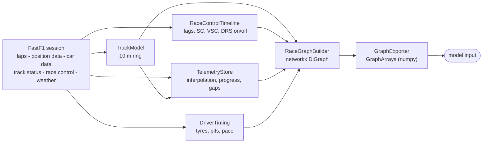

# Formula 1 Strategic Decisions

[](https://github.com/todortoth/Formula-1/actions/workflows/ci.yml)


Turn [FastF1](https://github.com/theOehrly/Fast-F1) race data into **graph snapshots** that a machine-learning
model (the long-term plan is a BERT-style encoder) can learn from: for any moment of a race you get a ring of track
points every ~10 m - carrying geometry, sectors, DRS zones and the current flag state - plus one node per driver
with position, speed, heading, tyres, pit state, pace and true time gaps. The project's goal is to analyse races and
find optimal strategic decisions; this repository is the data foundation for that.

<p align="center">
  <br>
  <em>A real snapshot (2025 Belgian GP, lap 44, the moment the leader crosses the sector 2 line). Grey dots are the
  10 m track nodes, green rings the DRS zones, blue dots cars with their heading, thin lines the proximity edges.</em>
</p>

## Contents

- [Features](#features)
- [Installation](#installation)
- [Quick start](#quick-start)
- [How it works](#how-it-works)
- [Continuous data and animation](#continuous-data-and-animation)
- [The graph schema](#the-graph-schema)
- [Using the graph with a model](#using-the-graph-with-a-model)
- [Command line reference](#command-line-reference)
- [Conventions](#conventions)
- [Limitations and caveats](#limitations-and-caveats)
- [Testing and continuous integration](#testing-and-continuous-integration)
- [Project structure](#project-structure)
- [Migrating from the flat layout](#migrating-from-the-flat-layout)
- [Bulk export](#bulk export)
- [Pre training](#self-supervised-pre-training-bert-over-race-snapshots)
- [Acknowledgements and disclaimer](#acknowledgements-and-disclaimer)

## Features

- **Track backbone every ~10 m.** A closed centre line rebuilt from a clean reference lap's position telemetry, with
  heading, curvature, gradient, official sectors, corner numbers, marshal sectors and inferred DRS zones per node.
- **Race control per track point.** Green / yellow / double yellow / safety car / VSC / VSC ending / red. Sector
  yellows are placed on exactly the marshal sector they were issued for; SC, VSC and red apply to the whole track.
- **Rich driver nodes.** Position (x, y, z), speed, velocity, heading and heading relative to the track, throttle,
  brake, gear, RPM, DRS, distance from the racing line, tyre compound / age / stint, pit stops, pit-lane state, recent
  pace, classified position.
- **True time gaps.** "How long ago was the car ahead where this car is now", not an approximation from lap ends.
  Lapped traffic is connected by physical proximity.
- **Global context.** Track status, DRS enabled/disabled, safety-car announcements, weather and race progress.
- **Causal snapshots.** The graph at time *t* does not depend on data after *t* (see
  [Snapshots and causality](#snapshots-and-causality)); this is enforced by a test.
- **Continuous data, up to 10 Hz.** The graph is sampled on a dense time grid (every second, or 10 times per second)
  into a compact `RaceSequence`: static track data stored once, bit-packed flags, fixed driver slots, dense edge matrices; training
  windows, exact frame reconstruction and a continuity check included.
- **Honest about the telemetry rate.** FastF1's position and car data arrive at ~4.5 Hz each (merged ~8-9 Hz); a 10 Hz
  grid interpolates between real samples, and every driver row carries `pos_age_s` / `car_age_s` (the age of the newest
  real sample) so a model can tell real from interpolated values.
- **Parquet export with Polars.** Races are streamed to a chunked Parquet dataset (bounded memory, ~54 000 frames at 10 Hz),
  with masked values stored as real nulls; query it lazily with Polars or read any frame range back into a `RaceSequence`.
- **Animated GIF** of the same arrays (flag-coloured track, cars with trails, leaderboard, flag banner), next to the
  original point-by-point graphs and PNGs, which are unchanged.
- **Model-ready export.** Fixed, named feature schema (one-hot, sin/cos, zero-filled with masks), optional
  normalisation, track pooling to fit a 512-token limit, token-type / position ids.
- **Degrades gracefully** when FastF1 lacks circuit info, sector times, DRS data, weather or race-control messages.

## Installation

Requires Python 3.10 or newer.

```bash
git clone https://github.com/todortoth/Formula-1.git
cd Formula-1
python -m venv .venv
source .venv/bin/activate          # Windows: .venv\Scripts\activate
pip install -e .                   # runtime only
pip install -e ".[dev]"            # plus pytest, coverage, hypothesis, ruff, build
```

FastF1 downloads data from F1's live-timing servers on first use and caches it (default `~/fastf1_cache`, override
with `--cache-dir` or the `F1_CACHE_DIR` environment variable). A full race with telemetry is a large download.

## Quick start

### Command line

```bash
python main.py                                     # 2025 Belgian GP, race, lap 44 (the original example)
f1-graph --year 2024 --event Monza --lap 30        # same as: python -m f1strategy ...
f1-graph --lap 10 --sectors "Sector 2" --no-tables
python main.py --continuous --from-lap 44 --to-lap 46    # + Parquet dataset and a GIF of laps 44-46 (1 frame/s)
python main.py --continuous --hz 10 --from-lap 1 --to-lap 44 --no-snapshots --no-gif   # a whole race at 10 Hz
```

For each requested sector it prints the lap tables, builds the graph at the moment the **leader** crosses that sector
line, saves a plot (`graphs/graph_sector2.png`) and the model arrays (`graphs/graph_lap44_sector2.npz`).
With `--continuous` it additionally writes a Parquet dataset `graphs/sequence_lap44-46/` (or an `.npz` with
`--format npz`) and `graphs/sequence_lap44-46.gif` (see [Continuous data and animation](#continuous-data-and-animation)). All options are listed in the
[command line reference](#command-line-reference).

### Python

```python
from f1strategy import GraphExporter, SessionAnalyser, suggest_pool_factor

analyser = SessionAnalyser(2025, "Belgian Grand Prix", "R")    # downloads / loads from cache
print(analyser.track)                                          # e.g. TrackModel(695 nodes, length=6947 m, ...)

# 1) a snapshot when the leader of lap 44 crosses the sector 2 line
G = analyser.build_session_graph(target_lap=44, sector_name="Sector 2")

# ... or at any session time (seconds since the start of the data stream)
G = analyser.build_graph_at_time(3600.0)

G.nodes["T0042"]["flag_label"]       # 'CLEAR' | 'YELLOW' | 'DOUBLE YELLOW' | 'SC' | 'VSC' | 'VSC ENDING' | 'RED'
G.nodes["VER"]["speed_kmh"]          # driver nodes are keyed by their 3 letter code
G.graph["global"]["is_sc"]           # graph-level context

# 2) model-ready arrays
arrays = GraphExporter(normalise=True).export(G)
arrays = arrays.pool_track(suggest_pool_factor(len(arrays.track_x), len(arrays.driver_codes)))
arrays.track_x.shape, arrays.driver_x.shape, arrays.global_x.shape
```

For many snapshots in a row use the [continuous API](#continuous-data-and-animation):

```python
from f1strategy import make_gif

seq = analyser.build_sequence_for_laps(44, 46, hz=10)         # leader's laps 44-46 at 10 Hz, in memory
print(seq.continuity_report().summary())
seq.save("spa_44-46.npz")
make_gif(seq, "spa_44-46.gif", colors=analyser.driver_colors(), every=5, fps=10)

# a whole race does not fit in memory at 10 Hz: stream it to Parquet instead
ds = analyser.write_sequence_parquet_for_laps("spa.ds", 1, 44, hz=10)
```

The first snapshot of a session is slower: every driver's progress curve over the whole race is computed once and
cached.

## How it works



`SessionAnalyser` is the facade: it loads the session, builds the four components and exposes
`build_session_graph` / `build_graph_at_time`.

### Track model

FastF1 has no track outline, so it is rebuilt from the position telemetry of the fastest *clean* lap (timed, accurate,
no pit in/out lap, not lap 1, preferably green flag only). The lap is closed and resampled by arc length into
`round(length / 10 m)` nodes, so the real spacing is `length / n`, i.e. 10 m +- ~0.5 %. Node 0 sits on the
start/finish line. Heading and curvature come from a lightly smoothed (~12 m) copy of the line; node positions stay raw.

| Layer | Source |
|---|---|
| Official sectors S1 / S2 / S3 | The reference lap's `Sector1SessionTime` / `Sector2SessionTime` projected onto the line (equal thirds as a fallback, with a warning). |
| Corner numbers | `session.get_circuit_info().corners` projected onto the line. |
| Marshal sectors | `session.get_circuit_info().marshal_sectors`; each marker is taken as the *start* of its sector, and the nodes before the first marker wrap to the last sector. |
| DRS zones | Inferred from where any car had the DRS channel open (10, 12, 14) across the whole session: busy nodes are merged into zones of at least 100 m. |
| DRS detection points | Not available from the API - see [Limitations](#limitations-and-caveats). |

If circuit info cannot be fetched, corners and marshal sectors stay unknown (`-1`) and sector-specific yellows cannot be
placed on the track, but the global flag state is still reported.

### Race control and flags

Two feeds are combined by `RaceControlTimeline`:

| Feed | Provides |
|---|---|
| `session.track_status` | Global state: `1` clear, `2` yellow (sectors unknown), `4` safety car, `5` red, `6` VSC, `7` VSC ending. |
| `session.race_control_messages` | Per-marshal-sector yellow / double yellow / clear, "TRACK CLEAR", DRS enabled / disabled, "SAFETY CAR IN THIS LAP". |

Replay rules: status `1` clears every sector flag; a sector message sets or clears that sector; `TRACK CLEAR` clears all;
at the same instant, status events are applied before messages. The state at any time is a bisect lookup.
Per track node the builder derives `flag_yellow` / `flag_double_yellow` from the node's marshal sector and
`flag_sc` / `flag_vsc` / `flag_vsc_ending` / `flag_red` from the global status, plus a single `flag_label` for plotting
(priority: RED > SC > VSC ENDING > VSC > DOUBLE YELLOW > YELLOW > CLEAR).

<p align="center">
  <br>
  <em>Synthetic test circuit (not a real track): a double yellow in marshal sector 3 and a yellow in sector 8 colour only
  their own stretch of track.</em>
</p>

> Note: an earlier version of `SectorNode` treated status `"7"` as the red flag. In FastF1 `"5"` is red and `"7"` is
> VSC ending; this is fixed and covered by a regression test.

### Driver state

`TelemetryStore` makes the telemetry random-access. Position (~220 ms) and car data (~240 ms) are on different clocks,
so both are interpolated (linearly for continuous channels, nearest sample for gear / brake / DRS). Each car is then
projected onto the track, which gives its exact distance along the lap and offset from the racing line.

*Progress* is the unwrapped cumulative distance, anchored so that it is 0 at the start/finish line at lights-out
(grid slots are slightly negative, formation laps do not matter). From the progress curves the true time gap follows:
the time at which the car ahead was at the progress where the car behind is now.

`DriverTiming` adds tyre compound / age / stint, pit-lane entries and pit-lane state, the mean of the last three
representative laps (no in/out laps, none with SC / VSC / red), and the classified position.

### Snapshots and causality

`build_graph_at_time(t)` returns the graph of the whole race at session time `t`. `build_session_graph(lap, sector)`
chooses `t` as the moment the **leader** of that lap crosses the sector line (or the lap start without a sector).

Continuous sequences inherit this, since every frame is such a snapshot. A snapshot only uses information available at `t`: lap times of laps that have not finished are not used, pit stops are
a count of entries so far, DRS is "disabled" until a message enables it. `tests/integration/test_causality.py` builds each
graph twice - from the full session and from one with everything after `t + 2 s` deleted - and requires identical
results. Exceptions, stated honestly:

- Interpolation and velocity use the neighbouring samples, i.e. at most ~0.3 s beyond `t`.
- The track layout and the DRS zones are static properties derived from the whole session.
- `finished_or_retired` depends on the final lap timestamp of a driver; it is never true before that time + 5 s.

## Continuous data and animation

The graph is a function of session time, so *continuous* data is that function sampled densely. The sector
snapshots (`build_session_graph`) are one coarse way of choosing `t`; they are kept as they were, and every frame of a
continuous sequence goes through exactly the same code (`build` + `export`), so the two can never disagree.

<p align="center">
  <br>
  <em>The animation, rendered from a <strong>synthetic</strong> test circuit with six cars (a real-race GIF needs
  network access to F1's servers): a yellow and a double yellow in two marshal sectors, DRS switching on, then the
  safety car with a retired car marked OUT.</em>
</p>

### Sampling

```python
seq = analyser.build_sequence_for_laps(44, 46, step_s=1.0)                  # by lap window (leader's laps)
seq = analyser.build_sequence(start_s=3600.0, end_s=3720.0, step_s=0.5)     # or by session time
```

| Step | Use |
|---|---|
| `hz=10` (0.1 s) | the finest useful resolution: a bit more than twice the real rate of each stream, see [below](#10-hz-and-the-real-telemetry-rate) |
| above ~10 Hz | adds frames, no information |
| 0.5 - 1 s | a good range for most sequence models |
| 2 - 5 s | quick experiments, small datasets |

Give either `step_s` or `hz` (never both).

Cost, measured on the synthetic circuit with 714 track nodes and a 20-car grid: about 7-8 ms per frame on the dense path
(about 20 ms through the full graph), i.e. roughly 7 minutes for a 90 minute race at 10 Hz; real data will differ, and
the first frame also computes every driver's progress curve once. `analyser.iter_graphs(times)`
yields the full networkx graphs lazily if you want the point-by-point objects instead. Under the hood
`analyser.sequence_builder` (a `SequenceBuilder`) evaluates the graph on the grid made by `time_grid(start, end, step)`;
both can be used directly.

### 10 Hz and the real telemetry rate

FastF1 delivers two *asynchronous* streams: position (X/Y/Z) about every 220 ms and car data (speed, throttle, brake,
gear, RPM, DRS) about every 240 ms, i.e. roughly 4.5 Hz and 4.2 Hz. Both intervals are documented by FastF1 ("usually" 220 ms and 240 ms). Merging the two clocks, as FastF1's merged
telemetry does, therefore gives roughly 8-9 samples per second (the sum of the two rates, ~8.7 Hz). The first lines of continuous mode print the rates **measured** on the session you load
(`analyser.telemetry_rates()`).

A 10 Hz grid therefore uses every real sample, but a frame usually falls *between* two samples, so its values are
interpolated (linearly for continuous channels, nearest sample for gear / brake / DRS). Nothing is hidden: every driver
row carries `pos_age_s` and `car_age_s`, the time since the newest real sample behind the value (0 exactly at a sample,
at most about one sampling interval while data flows; on a 10 Hz grid the mean is about half an interval). A model can
use them to learn how much to trust a value. Sampling faster than ~10 Hz only adds interpolated frames.

### What is stored

A `RaceSequence` is a set of arrays. Stacking full per-frame arrays would be wasteful (at one frame per second the
track tokens alone would be 469 MB for a 90 minute race, and nearly all of it never changes), so:

- **static track features** are stored once; everything except `flag_yellow`, `flag_double_yellow`, `flag_sc`, `flag_vsc`, `flag_vsc_ending`, `flag_red`, `n_drivers` is static;
- the six flags `flag_yellow`, `flag_double_yellow`, `flag_sc`, `flag_vsc`, `flag_vsc_ending`, `flag_red` are **bit-packed** into one `uint8` per node and frame; `n_drivers` is derived;
- **drivers sit in fixed slots** (alphabetical by code), so a car keeps its row across time; the live race position is
  the `position` feature;
- **proximity edges are dense** `[T, D, D]` matrices (`edge_exists` + `edge_attr`), the natural shape for an attention bias;
- values are stored **raw** (physical units); normalisation and pooling are applied when a frame is read.

Estimated in-memory size for a full race (the compressed `.npz` is smaller):

| Array | Shape / dtype | Size |
|---|---|---|
| `track_flags` | `[T, N]` uint8 | 3.8 MB |
| `driver_x` + `driver_mask` | `[T, D, 45]` float32 + bool | 24.3 MB |
| `edge_attr` + `edge_attr_mask` + `edge_exists` | `[T, D, D, 7]` float32 + bool, `[T, D, D]` bool | 77.8 MB |
| `global_x` + `global_mask` | `[T, 23]` | 0.6 MB |
| `driver_to_track`, `driver_present`, `times` | `[T, D]`, `[T]` | 0.6 MB |
| **Total** | T = 5400, D = 20, N = 695 | **107 MB** |

### Parquet datasets (Polars)

At 10 Hz a race is ~54 000 frames; as dense arrays that is about 1.1 GB for 20 cars, more than a pipeline
should hold at once. `write_sequence_parquet` therefore **streams** the race into a dataset directory chunk by chunk, so
memory stays bounded however long the race is: peak memory is about proportional to `chunk_frames` (measured on the
synthetic race at roughly 0.1 MB per frame for a 20 car grid, i.e. ~200 MB at the default of 2000 frames), while
throughput is about 7-8 ms per frame either way. The format is Parquet written and read with
[Polars](https://pola.rs):

```python
ds = analyser.write_sequence_parquet_for_laps("spa.ds", 1, 44, hz=10, chunk_frames=2000, overwrite=True)
ds = analyser.write_sequence_parquet("spa.ds", start_s=3600, end_s=3720, hz=10)    # or by session time
print(ds)      # ParquetSequence(... frames, ... chunks, ... MB on disk)
```

| File | One row per | Content |
|---|---|---|
| `manifest.json` | - | schema, driver slots, chunk index; **written last**, a dataset without it refuses to open |
| `track.parquet` | track node | the static track features |
| `drivers/part-*.parquet` | frame and driver present | `frame`, `t`, `driver`, `slot`, `track_node` and all 45 driver features (about 1,080,000 rows for a 90 minute race at 10 Hz) |
| `global/part-*.parquet` | frame | `frame`, `t`, the global features, and the flagged marshal sectors as lists (`yellow_sectors`, `double_yellow_sectors`) |
| `edges/part-*.parquet` | proximity edge | `frame`, `t`, `src`, `dst` (+ slots), the edge features |

Missing values are real Parquet **nulls** (the exporter's mask), never zeros that look like data. Parts are time ordered
with statistics, so a query on `frame` or `t` skips the rest. Flags are stored compactly: a node is flagged when its
marshal sector is in the frame's list, and SC / VSC / VSC ending / red are the global features `is_sc` / `is_vsc` /
`is_vsc_ending` / `is_red`.

```python
import polars as pl
from f1strategy import ParquetSequence

ds = ParquetSequence.open("spa.ds")
drivers = ds.scan_drivers()                                           # LazyFrame: nothing is read yet
top = drivers.group_by("driver").agg(pl.col("speed_kmh").max()).sort("speed_kmh").collect()
under_sc = drivers.join(ds.scan_global().select("frame", "is_sc"), on="frame").filter(pl.col("is_sc") == 1)
smooth = drivers.sort("slot", "frame").with_columns(pl.col("speed_kmh").rolling_mean(10).over("driver"))

seq = ds.read_sequence(start_frame=0, stop_frame=3000, every=1)       # a dense RaceSequence for a range ...
lo, hi = ds.frame_range(start_s=3600, end_s=3720)                     # ... found by session time
for chunk in ds.iter_chunks(2000):                                    # bounded-memory pass over the whole race
    ...
print(ds.continuity_report().summary())                               # the continuity check, evaluated by Polars
```

A sequence that is already in memory can be written with `seq.to_parquet(path)` (which calls `write_dataset`), and
`ParquetSequenceWriter` can be driven chunk by chunk yourself (`with ParquetSequenceWriter(path) as w: w.append(chunk)`).

`read_sequence` returns exactly the `RaceSequence` that was written (every array is equal, a test checks it), so
`frame()`, `windows()` and the animation work on a dataset read back in pieces.

### Reading it back

```python
from f1strategy import RaceSequence

seq = RaceSequence.load("spa_44-46.npz")
frame = seq.frame(120, normalise=True, pool=2)         # GraphArrays: exactly what the exporter produces for that time

for window in seq.windows(length=30, stride=10):       # sliding windows for a sequence model
    frames = list(window.frames(normalise=True, pool=2))
    track = np.stack([f.track_x for f in frames])      # [30, N_pooled, F_track]
    drivers = np.stack([f.driver_x for f in frames])   # [30, D, F_driver]
```

`frame(i)` is identical to `GraphExporter().export(analyser.build_graph_at_time(t_i))` - a test checks every array.
`seq.slice(a, b)` returns views, not copies. The file format is versioned, and the flag bit layout is stored in the file
and checked on load.

### What "continuous" means here

- **Smooth quantities** (positions, speeds, gaps, progress) are interpolated, so they change smoothly from frame to frame.
- **Wrap-around is encoded safely.** `track_s_m` and `lap_fraction` jump from the end of the lap to 0 at the
  start/finish line; `lap_fraction_sin` / `lap_fraction_cos` do not, and `progress_m` grows monotonically. Headings are
  sin/cos pairs for the same reason.
- **Discrete quantities change in steps** by nature: flags, race positions, pit state, proximity edges (they appear when
  a gap crosses 5 s or 50 m), the DRS window. Values that are undefined at a moment (e.g. a gap to a car a lap away) are
  masked, and the mask toggles accordingly.
- **A sequence can check itself.** `seq.continuity_report()` returns a `ContinuityReport` that flags a car that moves further between two frames than its
  speed allows (a teleport: bad data or a wrong time step) and race progress running backwards, and counts start/finish
  crossings. On the synthetic race the largest observed step is 1.01 times what the car's speed implies.

### Animation

```python
from f1strategy import RaceAnimator

anim = RaceAnimator(seq, colors=analyser.driver_colors(), title="2025 Belgian GP")
anim.save_gif("race.gif", every=2, fps=10)       # looping GIF
anim.save_png(120, "frame.png")                  # a single frame
rgb = anim.render(120)                           # [H, W, 3] uint8, e.g. to feed ffmpeg / imageio for an MP4
```

It is drawn from the sequence arrays, i.e. from the numbers a model is trained on. Static elements are drawn once; per
frame only colours, positions and texts change. All frames of a GIF share **one palette**, so flag colours do not
flicker. Cars use team colours when `session.results` has them (a fixed palette otherwise): `analyser.driver_colors()`
is `team_colors(session, codes)`.

| Parameter | Meaning |
|---|---|
| `every` | use every n-th frame; playback speed is `every x step_s x fps` times real time |
| `fps` | GIF frame rate (GIF delays have 10 ms resolution; browsers clamp very fast GIFs) |
| `max_frames` | guard (default 800): a GIF holds all frames in memory while it is written, so a longer one raises with a suggested `every` |
| `palette_colors` | size of the shared palette, 2-256 |

The command line picks `every` automatically so the GIF has at most 300 frames; with a Parquet dataset it draws the
GIF from a *decimated read* (`read_sequence(every=n)`), so a long 10 Hz race is never loaded in full.

### The point-by-point logic is unchanged

```python
G = analyser.build_session_graph(44, "Sector 2")                    # a sector snapshot, as before
for G in analyser.iter_graphs(times):                               # ...or a graph per frame
    plot_race_graph(G, f"frame_{G.graph['time_s']:.0f}.png")        # the original PNG plot
```

`python main.py` without `--continuous` behaves exactly as before.

## The graph schema

The graph is a `networkx.DiGraph`. Every relation is stored in both directions so message passing works.

**Nodes**

| Type | Id | Count |
|---|---|---|
| `track` | `"T0000"` ... | one per ~10 m of circuit (ring) |
| `driver` | 3 letter code, e.g. `"VER"` | one per car |

**Edges**

| `edge_type` | Between | Attributes |
|---|---|---|
| `track_next` / `track_prev` | consecutive track nodes (ring) | `length_m` |
| `on_node` / `occupied_by` | driver <-> its nearest track node | `offset_m` (along the track from the node), `lateral_m` |
| `proximity` | driver <-> driver | see the edge table below; created when the time gap is at most 5 s **or** the cars are within 50 m on the track (catches lapped traffic) |

**Graph attributes** (`G.graph`): `time_s`, `global` (dict, below), `track` (the `TrackModel`), `driver_codes`,
`driver_nodes` (`DriverNode` objects, ordered by race position), `race_control` (a `RaceControlState`: status, sector flags, DRS), `event`.

The tables below are the **exported feature schema** (`GraphExporter`); the same names exist as node / edge attributes
on the graph, except the derived ones (one-hots, sin/cos). They are checked against the code by a test.

### Track node features

<!-- BEGIN:track-features -->
| Feature | Meaning |
|---|---|
| `s_m` | Distance from the start/finish line along the lap, in metres. |
| `x_m` | World x of the node (frame of the FastF1 position feed), metres. |
| `y_m` | World y of the node, metres. |
| `z_m` | Elevation of the node, metres. |
| `heading_sin` | Direction of the track tangent, `sin(atan2(dy, dx))`. |
| `heading_cos` | Direction of the track tangent, `cos(atan2(dy, dx))`. |
| `curvature` | Signed curvature in 1/m, positive = left turn (from a ~12 m smoothed centre line). |
| `gradient` | Slope `dz/ds` (metre per metre). |
| `sector_1` | One-hot official timing sector 1 (boundaries come from the reference lap's sector times). |
| `sector_2` | One-hot official timing sector 2. |
| `sector_3` | One-hot official timing sector 3. |
| `is_corner` | 1 on the node closest to a numbered corner marker. |
| `corner_number` | Corner number of that marker (0 = none). |
| `marshal_sector` | Marshal sector the node lies in (-1 = unknown) - the unit in which sector yellow flags are issued. |
| `in_drs_zone` | Node is inside an inferred DRS activation zone. |
| `is_drs_start` | First node of a DRS zone (the activation line). |
| `is_drs_end` | Last node of a DRS zone. |
| `is_drs_detection` | Nearest node to a DRS detection point (only when you supply them, see Limitations). |
| `flag_yellow` | Yellow flag in this node's marshal sector. |
| `flag_double_yellow` | Double yellow in this node's marshal sector. |
| `flag_sc` | Safety car deployed (applies to every node). |
| `flag_vsc` | Virtual safety car deployed (every node). |
| `flag_vsc_ending` | VSC ending (every node). |
| `flag_red` | Red flag (every node). |
| `n_drivers` | Number of cars whose nearest track node is this one. |
<!-- END:track-features -->

### Driver node features

<!-- BEGIN:driver-features -->
| Feature | Meaning |
|---|---|
| `x_m` | Car position at the snapshot time (interpolated), metres. |
| `y_m` | Car position y, metres. |
| `z_m` | Car elevation, metres. |
| `speed_kmh` | Speed from the car data channel, interpolated. |
| `vx_mps` | Velocity x from the position feed (central difference over +-0.3 s), m/s. |
| `vy_mps` | Velocity y, m/s. |
| `heading_sin` | Direction of travel `sin(atan2(vy, vx))`; below 2 m/s the track tangent is used instead. |
| `heading_cos` | Direction of travel, cosine. |
| `heading_rel_track_sin` | Heading relative to the track tangent, sine (about 0 when aligned; large when spinning or in the pit lane). |
| `heading_rel_track_cos` | Heading relative to the track tangent, cosine. |
| `throttle` | Throttle in percent. |
| `brake` | Brake on (0/1). |
| `gear` | Gear. |
| `rpm` | Engine revs. |
| `drs_open` | DRS flap open (raw DRS channel 10, 12 or 14). |
| `drs_eligible` | Raw DRS channel equals 8 ("detected / eligible"; semantics are not officially documented). |
| `track_s_m` | Distance from the start/finish line of the car's projection onto the centre line, metres. |
| `lap_fraction` | `track_s_m` divided by the track length (jumps from 1 to 0 at the start/finish line). |
| `lap_fraction_sin` | `sin(2 pi lap_fraction)`: the wrap-safe encoding of the lap position, continuous across the line. |
| `lap_fraction_cos` | `cos(2 pi lap_fraction)`. |
| `lateral_offset_m` | Signed distance from the reference line, metres (+ = left). |
| `progress_m` | Cumulative race distance (laps x length + position); 0 at the line at lights-out, grid slots are slightly negative. |
| `lap_number` | Lap the car is on, from the timing table. |
| `position` | Live race position, ranked by `progress_m`. |
| `official_position` | Classified position at the end of the car's last completed lap (NaN before the first). |
| `gap_to_leader_s` | True time gap to the leader: how long ago was the leader where this car is now. |
| `gap_ahead_s` | Same, to the car directly ahead (NaN for the leader). |
| `gap_behind_s` | Same, of the car directly behind to this car (NaN for the last car). |
| `tyre_age` | Laps on the current set (FastF1 `TyreLife`). |
| `fresh_tyre` | Current set was new when fitted. |
| `stint` | Stint number. |
| `pit_stops` | Pit lane entries so far (a pure count of entries up to the snapshot time). |
| `in_pit` | Car is in the pit lane right now (between pit entry and the next lap's pit exit). |
| `on_track` | Position feed status is not `OffTrack`. |
| `pos_age_s` | Seconds since the newest *real* position sample behind this row (0 exactly at a sample, up to ~0.22 s; NaN before the first sample, grows if the stream stops). |
| `car_age_s` | Same for the car-data stream (speed, throttle, ...; ~0.24 s interval). |
| `pace_last3_s` | Mean of the last three completed representative laps (no in/out laps, none with SC/VSC/red), seconds. |
| `last_lap_time_s` | Time of the last completed lap, seconds. |
| `finished_or_retired` | More than 5 s have passed since the car's final lap timestamp. |
| `compound_soft` | One-hot: current tyre compound is SOFT. |
| `compound_medium` | One-hot: current tyre compound is MEDIUM. |
| `compound_hard` | One-hot: current tyre compound is HARD. |
| `compound_intermediate` | One-hot: current tyre compound is INTERMEDIATE. |
| `compound_wet` | One-hot: current tyre compound is WET. |
| `compound_unknown` | One-hot: compound unknown / not in the list above. |
<!-- END:driver-features -->

### Global features

<!-- BEGIN:global-features -->
| Feature | Meaning |
|---|---|
| `time_s` | Snapshot time in session seconds. |
| `leader_lap` | Lap of the race leader. |
| `laps_remaining` | Scheduled laps minus leader lap (NaN if unknown). |
| `race_fraction` | Leader lap divided by scheduled laps. |
| `is_green` | No flag anywhere: track status clear and no sector flags. |
| `is_yellow` | Yellow somewhere: track status yellow or any sector flagged. |
| `is_sc` | Safety car deployed. |
| `is_vsc` | Virtual safety car deployed. |
| `is_vsc_ending` | VSC ending. |
| `is_red` | Red flag. |
| `sc_in_this_lap` | Race control announced "SAFETY CAR IN THIS LAP" (reset at all-clear). |
| `yellow_unlocalised` | Track status says yellow but no marshal sector is known (messages missing). |
| `n_yellow_sectors` | Number of marshal sectors currently under yellow / double yellow. |
| `drs_enabled` | Race control has enabled DRS. Disabled until the first enabling message; unknown (masked) if there is no message feed at all. |
| `air_temp` | Air temperature, deg C. |
| `track_temp` | Track temperature, deg C. |
| `humidity` | Relative humidity, percent. |
| `pressure` | Air pressure, mbar. |
| `rainfall` | Rain (0/1). |
| `wind_speed` | Wind speed, m/s. |
| `wind_direction_sin` | Wind direction, sine. |
| `wind_direction_cos` | Wind direction, cosine. |
| `n_drivers` | Number of cars in the snapshot. |
<!-- END:global-features -->

### Proximity edge features

<!-- BEGIN:edge-features -->
| Feature | Meaning |
|---|---|
| `gap_s` | Time gap seen from the source car; **positive = the target is ahead**. NaN when undefined (e.g. a lap apart, never reached that point). |
| `progress_gap_m` | Difference in cumulative race distance, target minus source, metres. |
| `circular_gap_m` | Shortest signed distance along the track ignoring laps, in (-L/2, L/2]; this is what connects lapped traffic. |
| `lap_diff` | Whole laps the target is ahead of the source (negative = behind). |
| `rel_speed_kmh` | Target speed minus source speed. |
| `order_neighbor` | The two cars are consecutive in the running order. |
| `drs_window` | Source is the follower, within 1.0 s of the target and on the same lap (approximates the DRS rule with the true gap). |
<!-- END:edge-features -->

## Using the graph with a model

`GraphExporter.export(G)` returns a `GraphArrays` with, per snapshot:

| Array | Shape | Content |
|---|---|---|
| `track_x`, `track_mask` | `[N, F_track]` | track node features; mask `True` = value present |
| `driver_x`, `driver_mask` | `[D, F_driver]` | driver features, ordered by race position |
| `global_x`, `global_mask` | `[1, F_global]` | global features |
| `track_edge_index` | `[2, 2N]` | the ring, both directions |
| `driver_to_track` | `[D]` | track node (token) of every driver |
| `driver_edge_index`, `driver_edge_attr` | `[2, E]`, `[E, F_edge]` | proximity edges |

Categorical values are one-hot (compound, sector), angles are sin/cos, missing values are `0` with a mask (never NaN).
`GraphExporter(normalise=True)` rescales with rough physical constants (x / y by the track's bounding box, progress by
the race distance); for real training, compute statistics on your training set instead. `GraphArrays.validate()`
checks internal consistency and runs automatically after export and pooling. `to_dict()` is ready for
`np.savez_compressed`, `to_torch()` returns tensors if PyTorch is installed.

### BERT token budget

A BERT encoder has 512 positions. One token per driver plus a global token plus one per track node does not fit: at
10 m, Spa has 695 track nodes. `pool_track(factor)` merges neighbouring nodes (flags, DRS and corner markers use *max*
so no event is lost, continuous features use the mean, `n_drivers` is summed) and
`suggest_pool_factor(n_track, n_drivers, max_tokens=512)` picks the smallest factor that fits (2 for Spa with 20
drivers). `token_layout()` returns `token_type_ids` (0 global, 1 driver, 2 track) and per-type `position_ids`.

The three token types have different feature widths, so the model needs one linear projection per type plus a
token-type embedding, then feeds `inputs_embeds` to the encoder. A sketch (not part of the package and not run in this
repository's tests - adapt it freely):

```python
import torch
import torch.nn as nn
from transformers import BertConfig, BertModel


class RaceGraphEncoder(nn.Module):
    def __init__(self, n_global, n_driver, n_track, hidden=256):
        super().__init__()
        cfg = BertConfig(hidden_size=hidden, num_hidden_layers=4, num_attention_heads=4,
                         intermediate_size=4 * hidden, max_position_embeddings=512, type_vocab_size=3)
        self.bert = BertModel(cfg, add_pooling_layer=False)
        self.proj = nn.ModuleList([nn.Linear(n_global, hidden), nn.Linear(n_driver, hidden), nn.Linear(n_track, hidden)])

    def forward(self, g, d, t, token_type_ids, position_ids):          # g [B,1,Fg]  d [B,D,Fd]  t [B,N,Ft]
        x = torch.cat([self.proj[0](g), self.proj[1](d), self.proj[2](t)], dim=1)
        return self.bert(inputs_embeds=x, token_type_ids=token_type_ids, position_ids=position_ids).last_hidden_state
```

Not included yet: an attention mask encoding the ring / driver-to-track structure, and training targets (see
[Roadmap](#roadmap)).

## Command line reference

`python main.py`, `python -m f1strategy` and `f1-graph` are equivalent.

<!-- BEGIN:cli-options -->
| Option | Default | Meaning |
|---|---|---|
| `--year` | 2025 | Season. |
| `--event` | `Belgian Grand Prix` | Event name (fuzzy-matched by FastF1) or, if all digits, the round number. |
| `--session` | `R` | Session identifier: `R`, `Q`, `S`, `SQ`, `FP1`... |
| `--lap` | 44 | Lap whose sector crossings define the sector snapshots (taken when the **leader** crosses the sector line). |
| `--sectors` | all three | Any of `"Sector 1"` `"Sector 2"` `"Sector 3"`. |
| `--out-dir` | `graphs` | Where PNGs and `.npz` files go. |
| `--spacing` | 10 | Track node spacing in metres. |
| `--max-tokens` | 512 | Token budget used to choose the track pooling factor. |
| `--drs-detection-offset` | none | Estimate DRS detection points as *zone start minus this many metres*. |
| `--cache-dir` | `$F1_CACHE_DIR` or `~/fastf1_cache` | FastF1 cache directory. |
| `--continuous` | off | **Continuous mode**: also sample the race graph densely over a lap window, save it and render a GIF. |
| `--from-lap` | `--lap` | First lap of the continuous window (starts when the leader starts it). |
| `--to-lap` | `--from-lap` | Last lap of the window (ends when the leader completes it). |
| `--step` | 1.0 | Seconds between two frames (or give `--hz`). |
| `--hz` | none | Frames per second of *data*, e.g. `10`; an alternative to `--step` (not the GIF rate: that is `--fps`). |
| `--format` | `parquet` | Dataset format: `parquet` (a directory, streamed in chunks), `npz` (one file, in memory) or `both`. |
| `--chunk-frames` | 2000 | Frames per Parquet part / in-memory chunk; this is what bounds the memory use. |
| `--gif-every` | auto | Use every n-th frame in the GIF; automatic means at most 300 frames. |
| `--fps` | 10 | Playback frames per second of the GIF. |
| `--no-gif` | off | Continuous mode: write only the dataset, no GIF. |
| `--no-snapshots` | off | Skip the sector snapshots (tables, plots, npz); needs `--continuous`. |
| `--no-tables` | off | Skip the console tables (sector snapshots). |
| `--no-plots` | off | Skip the PNG plots. |
| `--no-export` | off | Skip the `.npz` export. |
| `--verbose` | off | Debug logging (`-v`). |
<!-- END:cli-options -->

## Conventions

- **Units.** Metres, km/h (speed) and m/s (velocity), radians, seconds. FastF1 positions are in 1/10 m and are converted
  on the way in.
- **Session time.** Seconds since the start of the data stream (FastF1 `SessionTime`), *not* since the race start.
- **Angles** are `atan2(dy, dx)` in the position feed's frame; `curvature > 0` is a left turn.
- **Ids.** Track nodes `T0000`..., drivers by their 3 letter code.

## Limitations and caveats

- **DRS detection points are not in any F1 data feed.** Pass them yourself (`drs_detection_points_m=[...]`, metres from
  the start/finish line) or estimate them (`drs_detection_offset_m`: zone start minus an offset). The nearest 10 m node is
  flagged `is_drs_detection`, so it is within 5 m of the exact point. DRS activation zones themselves *are* inferred
  from telemetry.
- **Marshal sector markers** are assumed to mark the *start* of each sector. If sector flags look shifted on a real
  circuit, this is the assumption to check.
- **DRS channel semantics.** Values 10, 12, 14 are treated as "open" and 8 as "eligible"; FastF1 documents these as
  needing more research. `drs_window` approximates the 1 s rule with the true gap, not with the timing at the detection point.
- **Pit lane** is not modelled geometrically: a car in the pit lane is projected to the nearest main-track node; use
  `in_pit`.
- **One outline per session** - taken from one lap, so temporary track changes within a session are not represented.
- **Not included yet:** per-driver blue flags, penalties, forecasts, anything outside the FastF1 feeds.
- **Minimum versions.** The declared lower bounds (numpy 1.24, pandas 2.0, scipy 1.10, networkx 3.0, matplotlib 3.7,
  FastF1 3.4) are exercised by CI, but with FastF1 itself mocked: they show the code works with those versions, not that
  FastF1 3.4's live API behaves identically. Development and the real Spa run used a current FastF1.
- **Data quality is FastF1's.** Missing drivers, missing telemetry and all-zero position samples are handled (zero
  samples are dropped), but wrong source data stays wrong.
- **FastF1 versions.** `fastf1>=3.4` is declared; the API surface used was inspected against FastF1 3.8.3 and the real
  run used a current release. The offline tests inject the session instead of importing FastF1, so older FastF1
  releases are only checked at install level.
- **Continuous mode on real races.** It is covered by synthetic tests (including exact equality with the point-by-point
  exporter and a continuity check), but I could not run it on a real race from the development environment: run
  `python main.py --continuous` once and read the printed continuity report; `tests/live` contains matching checks.
- **Parquet datasets on real races** are covered by exact round-trip tests on synthetic data (every array equal, masks as
  nulls, chunk boundaries, Polars queries) but have not yet been written for a real 10 Hz race here; `tests/live`
  contains matching checks. The `edges` table grows with how many cars run within 5 s / 50 m of each other.
- **10 Hz is interpolated.** The real streams are ~4.5 Hz; see [10 Hz and the real telemetry rate](#10-hz-and-the-real-telemetry-rate).
- **GIFs live in memory while they are written** (8-bit frames), hence the `max_frames` guard; use `every` or a shorter
  window for long races. There is no built-in video encoder; `render(i)` gives you the frames.
- **Verification status.** The logic is covered by several hundred tests on a synthetic session with known ground truth.
  The full pipeline has been run on real data for the 2025 Belgian Grand Prix (695 nodes, 20 drivers). Other circuits and
  seasons are expected to work but have not been checked individually - the [live tests](#live-tests) are meant to grow
  that coverage.

## Testing and continuous integration

```bash
pip install -e ".[dev]"
python -m pytest                           # offline tests (default)
python -m pytest --cov                     # with coverage
python -m pytest -m live tests/live        # live tests against the real API (network, slow)
ruff check . && ruff format --check .      # lint + format
```

### Test tiers

| Tier | Where | What |
|---|---|---|
| Unit | `tests/unit` | One module at a time: geometry on analytic shapes (a circle has a known curvature), race-control replay, telemetry interpolation, anchoring, timing, exporter, plotting, CLI helpers. Includes property-based tests (hypothesis). |
| Integration | `tests/integration` | End to end: dataset assembly, determinism, **causality**, continuous workflow (file -> windows -> tensors -> GIF), CLI. |
| Live | `tests/live` | The real FastF1 API on the 2025 Belgian GP. Deselected by default. |

All offline tests run against `tests/synthetic/session.py`: a synthetic session that mimics FastF1's structure (column
names, units, dtypes, quirks such as all-zero position samples and the separate clocks) around a circuit with *exactly
known* geometry, positions, gaps, flags, a pit stop, a retirement, an SC, a VSC and DRS windows. Each data source can be
switched off to test degraded input. Warnings are treated as errors.

### Documentation

`README.md` is generated: the feature tables, the command line table and the storage table come from the code. Edit
`docs/readme_template.md` and run `python scripts/generate_readme.py` (`--check` verifies); a test fails when the README is
stale.

### Live tests

They need network access to F1's servers and download hundreds of MB on first use, so they run in a separate scheduled
workflow rather than on every push. Their reference values come from a real run on the 2025 Belgian GP.

### GitHub Actions

| Workflow | Trigger | Does |
|---|---|---|
| `ci.yml` | push to `master`/`main`, pull requests | lint + format check; tests on Python 3.10-3.13 (Linux) and 3.12 (Windows) with a 95 % coverage gate; tests against the *minimum* supported dependency versions; package build + install of the wheel. |
| `live-data.yml` | weekly, manual | the live tests, with the FastF1 cache cached between runs. |

## Project structure

<!-- BEGIN:project-structure -->
```
Formula-1/
├── main.py                       launcher: python main.py (works without installing)
├── pyproject.toml                packaging, dependencies, pytest / ruff / coverage config
├── scripts/
│   └── generate_readme.py        renders README.md from docs/readme_template.md
├── src/f1strategy/
│   ├── __init__.py               public API, __version__
│   ├── __main__.py               python -m f1strategy
│   ├── cli.py                    command line interface
│   ├── session.py                SessionAnalyser: loads the session, builds components, facade
│   ├── plotting.py               track map of a race graph (PNG)
│   ├── animation.py              RaceAnimator: GIF from a RaceSequence
│   ├── reporting.py              console tables
│   ├── utils.py                  units, position cleaning, circular runs, time formatting
│   ├── domain/
│   │   ├── driver.py             DriverNode
│   │   └── sector.py             SectorNode, track status codes
│   ├── track/
│   │   └── model.py              TrackModel: the 10 m ring + layout layers
│   ├── racecontrol/
│   │   └── timeline.py           RaceControlTimeline: flags, SC, VSC, DRS on/off
│   ├── telemetry/
│   │   ├── store.py              TelemetryStore: interpolation, progress, gaps
│   │   └── timing.py             DriverTiming: tyres, pits, pace
│   ├── graph/
│   │   ├── builder.py            RaceGraphBuilder: networkx graph at a time
│   │   └── exporter.py           GraphExporter / GraphArrays: fixed-schema arrays
│   └── sequence/
│       ├── sampling.py           time_grid
│       ├── builder.py            SequenceBuilder: dense (graph-free) frames, chunked
│       ├── dataset.py            RaceSequence: compact continuous dataset
│       └── parquet.py            ParquetSequenceWriter / ParquetSequence (Polars)
├── tests/                        unit/, integration/, live/, synthetic/
├── docs/                         readme_template.md and the figures used in the README
└── .github/workflows/            ci.yml, live-data.yml
```
<!-- END:project-structure -->

## Migrating from the flat layout

| Old file | New location | Import |
|---|---|---|
| `SectorNodeClass.py` | `f1strategy/domain/sector.py` | `from f1strategy import SectorNode` |
| `DriverNodeClass.py` | `f1strategy/domain/driver.py` | `from f1strategy import DriverNode` |
| `TrackModelClass.py` | `f1strategy/track/model.py` | `from f1strategy import TrackModel` |
| `RaceControlTimelineClass.py` | `f1strategy/racecontrol/timeline.py` | `from f1strategy import RaceControlTimeline` |
| `TelemetryStoreClass.py` | `f1strategy/telemetry/store.py` | `from f1strategy import TelemetryStore` |
| `DriverTimingClass.py` | `f1strategy/telemetry/timing.py` | `from f1strategy import DriverTiming` |
| `RaceGraphBuilderClass.py` | `f1strategy/graph/builder.py` | `from f1strategy import RaceGraphBuilder` |
| `GraphExporterClass.py` | `f1strategy/graph/exporter.py` | `from f1strategy import GraphExporter` |
| `SessionAnalyserClass.py` | `f1strategy/session.py` | `from f1strategy import SessionAnalyser` |
| `main.py` | `f1strategy/cli.py` (+ thin `main.py`) | `python main.py` still works |

Changes in 0.4.0 (10 Hz and Parquet): two new driver features (`pos_age_s`, `car_age_s`, so 45 in total),
`RaceGraphBuilder.snapshot()` (plain data; `build()` now wraps it and returns the same graph), `GraphExporter.export_snapshot()`
and `FrameRecord`, a graph-free sampling path that is bit-for-bit equal to the graph path, `hz=` everywhere, Parquet
export / import (`polars` is now a dependency), and `--format parquet` is the default for `--continuous`
(`--step` now defaults to unset, meaning 1 s unless `--hz` is given). `FLAG_BITS` lives in `f1strategy.graph.exporter`
(still importable from `f1strategy.sequence.dataset`).

Changes in 0.3.0 (continuous data): normalisation moved into `GraphArrays.normalised_copy()` (the exporter output with
`normalise=True` is unchanged), `GraphArrays` gained `xy_bbox`, `race_distance_m` and `normalised`, two driver features
were added (`lap_fraction_sin`, `lap_fraction_cos`), and Pillow became a direct dependency.

Behaviour changes since the first graph version: pit stops are now a pure count of pit-lane entries up to `t`;
`drs_enabled` is `False` (not unknown) until a message enables DRS whenever a race-control feed exists; the normalised
`progress_m` is scaled by the race distance; pooling keeps the mask in the pooled shape.

## Bulk export

```bash
scripts/scape_data.ps1
scripts/scrape_data.sh
```

For exporting all 152 races from 2019 onward use the scrape data powershell/bash script. It iterates through the races
while exporting the data into the `parquet_datasets` folder. See [Datasets](#datasets) for more info.

# Self-supervised pre-training (BERT over race snapshots)

- [Model](#model)
- [The pretest tasks](#the-pretext-tasks)
- [Leakage controls](#leakage-controls-what-makes-the-tasks-non-trivial)
- [Training details](#training-details)
- [Data notes](#data-notes-from-the-2019-australian-gp-file)
- [Limitations](#not-done--limitations)

### Datasets

```bash
chmod +x scripts/scrape.sh
chmod +x scripts/scrape_data.sh
scripts/scrape.sh
```

Datasets are pulled from the FastF1 API, all races between 2019 and 2025. Each race generates a dataset in `parquet_datasets`
with all laps of the race included (except Belgium 2021, which fails with a Data Error). Log files are stored in `scraping_logs`.

To monitor:

```bash
ps -ef | grep -E "scrape.sh|scrape_data.sh" | grep -v grep
```

To test the integrity of the dataset use this helper function:

```bash
python /home/todortoth/F1/F1/tests/test_dataset.py /home/todortoth/F1/F1/parquet_datasets/2019_round_1.ds/sequence_lap1-58/ --out-gif "/home/todortoth/F1/F1/graphs/test.gif"
```

It generates a gif from the pulled dataset to visualize whether the dataset is functional or not.

`src/f1strategy/pretrain/` pre-trains a graph-aware BERT encoder on the Parquet datasets written by `main.py --continuous`.
There are **no labels and no fine-tuning** here: the output is an encoder checkpoint that fine-tuning (undercut / overcut,
pit-window, ...) can start from later.

```bash
pip install torch polars numpy                     # + pytest for the tests

# 1) Parquet datasets -> compact memory-mappable caches (decimated; 10 Hz is interpolated and heavily redundant)
python -m f1strategy.pretrain.cache --src parquet_datasets --dst cache --stride 5

# 2) pre-train
python -m f1strategy.pretrain.train --cache cache --out runs/pre1 --preset small --steps 100000 --batch-size 64 --amp
```

`--preset tiny|small|base` (0.5 M / ~5 M / ~15 M parameters). Resume with `--resume runs/pre1/last.pt`.
Later: `from f1strategy.pretrain.model import load_encoder; enc = load_encoder("runs/pre1/best.pt"); h = enc.encode(batch)`.

## Model

One token per snapshot element: `[GLOBAL] + 22 driver slots + 128 track tokens` (151 tokens; the 10 m ring is pooled to a fixed
128 tokens whatever the circuit, so a token is a fixed *fraction of the lap* and circuits share one position vocabulary).

* **Separate input projections** for global / driver / track features, token-type embedding, and a **ring-position embedding shared
  by cars and track**: a car gets the embedding of the track token it is on.
* **BERT encoder** (bidirectional, pre-LN, GELU). Driver slots carry no order or identity (slot = alphabetical code in that
  race), so the encoder is permutation-equivariant over cars (tested).
* **Graph structure as learned attention bias** per layer and head: circular ring-distance buckets between tokens, and the
  proximity-edge features of every car pair through a small MLP. Absent cars are masked as keys.
* **Inputs are `[value * visible, visible]`**, never a silently zeroed value; missing data (Parquet nulls) is "not visible".

## The pretext tasks

Every sample in a batch is assigned one task (default shares A 35 % / B 25 % / C 20 % / D 20 %), so each loss stays clean and
each task's leakage is controlled on its own.

| | Task | What is hidden | Predicted |
|---|---|---|---|
| **A** | Telemetry value regression | 15 % of the (car, channel) cells of `speed_kmh`, `throttle`, `brake`, `rpm` | the hidden values (`brake` is 0/1, so BCE instead of regression) |
| **B** | Ghost car | **all** features of one random car; the other cars and proximity edges stay | every feature of that car, incl. tyre compound (cross-entropy) |
| **C** | Flag / marshal-sector condition | *global mode*: all flag bits on all track tokens + all global status flags. *local mode*: yellow / double yellow on a few marshal sectors | yellow / double yellow per track token, `is_yellow/sc/vsc/red/...` from the global token |
| **D** | Strategy state (added) | 15 % of the (car, group) cells of: compound; tyre age / stint / stops / fresh; pace; gaps + position | the hidden values; this is the signal later fine-tuning for undercut / overcut needs |

### Leakage controls (what makes the tasks non-trivial)

Several inputs restate each other; hiding only the target would turn a task into a copy. Everything below is enforced in
`masking.py` and covered by `tests/pretrain/`.

* **speed -> `vx_mps`, `vy_mps` are hidden with it**: for a car on track `|v|` is 0.96 x speed (corr. 0.85 on the 2019 Australian GP).
* **Edge features restating a hidden car feature are hidden on every edge touching that car**: `rel_speed_kmh` (speed), and
  `gap_s`, `order_neighbor`, `drs_window` (gaps / position).
* **Flags**: the track flag bits (`flag_sc` etc. equal the global status), the global status flags and `drs_enabled` (switched off
  under SC) are hidden together; in local mode `is_yellow`, `is_green`, `n_yellow_sectors` are hidden too, since they reveal
  whether a masked sector is flagged.
* **Ghost car `ghost_edge_mode`**: `relational` (default, your spec: edges stay visible, only `rel_speed_kmh` and the car's own
  features are hidden), `topology` (edge existence only; ring position hidden too) or `none`. In `relational` mode the ghost's
  gaps/progress are largely derivable from its neighbours' edges, so `topology` is the harder, more informative variant.
* A test overwrites every hidden cell with garbage and requires bit-identical encoder output.

Known soft leak, left in on purpose: a car's time gap divided into the progress difference gives a smoothed speed over the last
seconds. That is genuine context, not a copy; hide the gap features together with speed if you want to remove it.

## Training details

* Loss: Huber for continuous, BCE for binary, cross-entropy for compound; flags use `pos_weight` (yellow 20, global flags 3).
  Task losses are averaged over their own target cells then summed with `--task-weights`.
* **Flagged frames are oversampled** (`--flag-oversample`, default 5x): flags are ~1 % of frames, but they are all of task C.
* **Validation never splits frames of the same race randomly** (neighbours are near duplicates): whole races are held out when
  >= 5 are available, else every 10th 180 s block of each race with a 60 s embargo on both sides (interleaved, not cut from the end:
  the last laps have progress / tyre-age values never seen in training, which would make validation an extrapolation test). Validation runs *every* task with fixed masks and
  reports physical-unit metrics next to a predict-the-mean baseline (e.g. `val/A_speed_kmh_mae` vs `..._baseline`).
* AdamW, linear warm-up + cosine decay, grad-clip 1, optional bf16 (`--amp`).

## Data notes (from the 2019 Australian GP file)

* Normalisation is per race (x/y by the circuit bounding box, distances by lap length / race distance, pace centred on the race's
  median pace; gap features use asinh). Statistics are fixed physical scales, not fitted on data, so a new race needs no refit.
* The cache keeps every `stride`-th frame (default 5 = 2 Hz) -> ~10 k frames and ~110 MB per race. `--stride 1` keeps all 10 Hz.
* Driver slots padded to 22, marshal sectors to 40; the cache builder fails loudly if the manifest schema changes.

## Not done / limitations

* No fine-tuning, no downstream heads or labels.
* Single snapshots only (no temporal context across frames); stacking a window of snapshots is the natural next step.
* Driver identity / team is not an input (slots are arbitrary per race), so the encoder cannot learn driver-specific behaviour yet.
* Task C needs flag events in the training data; a race with no SC/VSC contributes only yellow-sector signal.


## Acknowledgements and disclaimer

Built on [FastF1](https://github.com/theOehrly/Fast-F1); circuit layout details (corners, marshal sectors) come from the
MultiViewer API through FastF1. This is an unofficial project and is not associated with Formula 1 companies. F1, FORMULA
ONE, FORMULA 1, FIA FORMULA ONE WORLD CHAMPIONSHIP and related marks are trade marks of Formula One Licensing B.V.

There is currently no `LICENSE` file; add one before others reuse the code.
