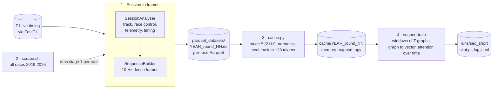
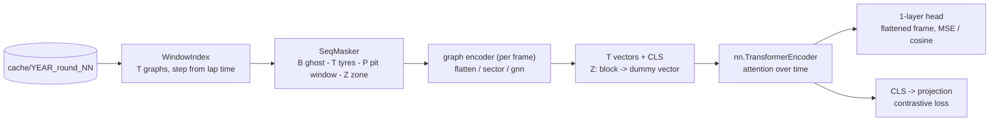

# Formula 1 Strategic Decisions

[](https://github.com/todortoth/Formula-1/actions/workflows/ci.yml)


Models Formula 1 races as **graphs** and pre-trains a transformer on them. The project has three layers that build on
each other:

1. **Graph snapshots.** [FastF1](https://github.com/theOehrly/Fast-F1) race data becomes, for any moment of a race, a ring
   of track points every ~10 m - carrying geometry, sectors, DRS zones and the current flag state - plus one node per
   driver with position, speed, heading, tyres, pit state, pace and true time gaps.
2. **A corpus.** The graph is sampled continuously (up to 10 Hz) and streamed to Parquet datasets; a bulk script does this
   for every race from 2019 to 2025 (152 scheduled rounds).
3. **Self-supervised pre-training.** A graph-aware BERT-style encoder (~5 M parameters) is pre-trained on that corpus
   with four masked-reconstruction tasks (telemetry, ghost car, flags, strategy state). There are no labels yet: the
   output is an encoder checkpoint that later fine-tuning (undercut / overcut, pit window, ...) can start from. A second, **temporal** model
   (`f1strategy.seqbert`) runs attention over *time*: one token per graph of a sequence of 10 s, 1 lap or 10 laps, pre-trained with
   ghost-car, tyre-set, pit-return-window and zone-masking tasks.

The long-term goal is to analyse races and find optimal strategic decisions; this repository is the data and
representation-learning foundation for that.

<p align="center">
  <br>
  <em>A real snapshot (2025 Belgian GP, lap 44, the moment the leader crosses the sector 2 line). Grey dots are the
  10 m track nodes, green rings the DRS zones, blue dots cars with their heading, thin lines the proximity edges.</em>
</p>

<p align="center">
  <br>
  <em>A real race rendered from the Parquet dataset the model is trained on (Barcelona, laps 40-50, decimated for the
  GIF). Track colour = flag state (here a virtual safety car), dots = cars with team colours, right = running order with
  gaps, tyre compound and pit state.</em>
</p>

## Contents

- [The pipeline at a glance](#the-pipeline-at-a-glance)
- [Features](#features)
- [Installation](#installation)
- [Quick start](#quick-start)
- **Stage 1 - graphs and continuous data**
  - [How it works](#how-it-works)
  - [Continuous data and animation](#continuous-data-and-animation)
  - [The graph schema](#the-graph-schema)
  - [Using the graph with a model](#using-the-graph-with-a-model)
  - [Command line reference](#command-line-reference)
  - [Conventions](#conventions)
- **Stage 2 - the corpus**
  - [Building the corpus (bulk scraping)](#building-the-corpus-bulk-scraping)
- **Stage 3 and 4 - pre-training**
  - [Training cache](#training-cache)
  - [Self-supervised pre-training](#self-supervised-pre-training)
  - [Model](#model)
  - [The pretext tasks](#the-pretext-tasks)
  - [Leakage controls](#leakage-controls-what-makes-the-tasks-non-trivial)
  - [Training details](#training-details)
  - [Results of the first run](#results-of-the-first-run)
  - [Using the checkpoint](#using-the-checkpoint)
  - [Pre-training limitations](#pre-training-limitations)
- **Stage 5 - temporal (sequence) pre-training**
  - [Temporal (sequence) pre-training](#temporal-sequence-pre-training)
  - [From snapshots to sequences](#from-snapshots-to-sequences)
  - [The three sequence scales](#the-three-sequence-scales)
  - [Windows and the validation split](#windows-and-the-validation-split)
  - [Step I: graph to vector](#step-i-graph-to-vector)
  - [The temporal BERT](#the-temporal-bert)
  - [The temporal pretext tasks](#the-temporal-pretext-tasks)
  - [Temporal leakage controls](#temporal-leakage-controls)
  - [Losses and metrics](#losses-and-metrics)
  - [Contrastive objective](#contrastive-objective)
  - [Training the temporal model](#training-the-temporal-model)
  - [Measured cost and the benchmark](#measured-cost-and-the-benchmark)
  - [Figures for reports](#figures-for-reports)
  - [Using a temporal checkpoint](#using-a-temporal-checkpoint)
  - [Status and limitations of the temporal model](#status-and-limitations-of-the-temporal-model)
- [Limitations and caveats](#limitations-and-caveats)
- [Testing and continuous integration](#testing-and-continuous-integration)
- [Project structure](#project-structure)
- [Repository artefacts](#repository-artefacts)
- [Changelog and migration](#changelog-and-migration)
- [Related work](#related-work)
- [Acknowledgements and disclaimer](#acknowledgements-and-disclaimer)

## The pipeline at a glance



| Stage                        | Entry point | Reads | Writes | Measured size / cost |
|------------------------------|---|---|---|---|
| **1. Session to frames**     | `python main.py --continuous --hz 10 ...` (`SessionAnalyser`, `SequenceBuilder`, `ParquetSequenceWriter`) | a FastF1 session (laps, position and car data, track status, race control, weather) | `<out-dir>/sequence_lap<a>-<b>/` Parquet dataset: `manifest.json`, `track.parquet`, `drivers/`, `global/`, `edges/` | 2019 Australian GP: 51,276 frames (10 Hz, 5,128 s), 26 chunks, 104.5 MB on disk (zstd) |
| **2. Corpus**                | `scripts/scrape.sh` -> `scripts/scrape_data.sh <year>` | the 2019-2025 calendars | `parquet_datasets/<year>_round_<NN>.ds/sequence_lap1-<N>/` per race, logs in `scraping_logs/` | 7 parallel workers, one per season; 152 rounds scheduled, Belgium 2021 fails (see [corpus](#building-the-corpus-bulk-scraping)) |
| **3. Training cache**        | `python -m f1strategy.pretrain.cache` | the Parquet datasets | `cache/<year>_round_<NN>/` with `meta.json` and `.npy` memory maps | stride 5 -> ~10 k frames and ~118 MB per race (2019 Australian GP: 10,256 frames) |
| **4. Temporal pre-training** | `python -m f1strategy.seqbert.train` | the caches (windows of 10 s / 1 lap / 10 laps) | `runs/<name>/ckpt.pt`, `log.jsonl`, `args.json` | `small` preset: 5.8-8.3 M parameters depending on the graph encoder; cost: see [measured cost](#measured-cost-and-the-benchmark) |
| **5. Inspection**            | `tests/test_dataset.py`, `tests/visualize_training.py`, `python -m f1strategy.pretrain.bench`, `python -m f1strategy.seqbert.bench`, `python -m f1strategy.seqbert.visualize` | a dataset / `train.log` / a cache | verification GIF, loss plot, per-step timing, report figures | - |

Each stage only depends on the files written by the previous one, so any stage can be re-run on its own. The **schema** is
the contract between the stages: the feature name lists (42 driver in the training schema, 23 global, 7 edge, 18 static track features, 6 flag
bits) are written into every dataset's `manifest.json`, and the cache builder refuses a dataset whose manifest differs
from the lists in `pretrain/schema.py`.

## Features

- **Track backbone every ~10 m.** A closed centre line rebuilt from a clean reference lap's position telemetry, with
  heading, curvature, gradient, official sectors, corner numbers, marshal sectors and inferred DRS zones per node.
- **Race control per track point.** Green / yellow / double yellow / safety car / VSC / VSC ending / red. Sector
  yellows are placed on exactly the marshal sector they were issued for; SC, VSC and red apply to the whole track.
- **Rich driver nodes.** Position (x, y, z), speed, velocity, heading and heading relative to the track, throttle,
  brake, gear, RPM, DRS, distance from the racing line, tyre compound / age / stint, pit stops, pit-lane state, recent
  pace, classified position.
- **True time gaps.** "How long ago was the car ahead where this car is now", not an approximation from lap ends.
  Lapped traffic is connected by physical proximity.
- **Global context.** Track status, DRS enabled/disabled, safety-car announcements, weather and race progress.
- **Causal snapshots.** The graph at time *t* does not depend on data after *t* (see
  [Snapshots and causality](#snapshots-and-causality)); this is enforced by a test.
- **Continuous data, up to 10 Hz.** The graph is sampled on a dense time grid (every second, or 10 times per second)
  into a compact `RaceSequence`: static track data stored once, bit-packed flags, fixed driver slots, dense edge matrices; training
  windows, exact frame reconstruction and a continuity check included.
- **Honest about the telemetry rate.** FastF1's position and car data arrive at ~4.5 Hz each (merged ~8-9 Hz); a 10 Hz
  grid interpolates between real samples, and every driver row carries `pos_age_s` / `car_age_s` (the age of the newest
  real sample) so a model can tell real from interpolated values.
- **Parquet export with Polars.** Races are streamed to a chunked Parquet dataset (bounded memory, ~54 000 frames at 10 Hz),
  with masked values stored as real nulls; query it lazily with Polars or read any frame range back into a `RaceSequence`.
- **A full-season corpus.** One command per season scrapes every race of 2019-2025 at 10 Hz into Parquet, resumable and
  logged per season.
- **Temporal graph BERT.** A second model (`f1strategy.seqbert`) turns every graph of a sequence into one vector (GNN, flatten or
  sector pooling) and runs a bidirectional `nn.TransformerEncoder` over *time*, on windows of 10 s, 1 lap or 10 laps. Pre-trained
  with ghost-car, tyre-set, pit-return-window and zone masking plus an optional contrastive objective; benchmark script and
  report figures included.
- **Animated GIF** of the same arrays (flag-coloured track, cars with trails, leaderboard, flag banner), next to the
  original point-by-point graphs and PNGs, which are unchanged.
- **Model-ready export.** Fixed, named feature schema (one-hot, sin/cos, zero-filled with masks), optional
  normalisation, track pooling to fit a 512-token limit, token-type / position ids.
- **Degrades gracefully** when FastF1 lacks circuit info, sector times, DRS data, weather or race-control messages.

## Installation

Requires Python 3.10 or newer. PyTorch (>= 2.7.1) is a declared dependency because the pre-training package imports it.

```bash
git clone https://github.com/todortoth/Formula-1.git
cd Formula-1
python -m venv .venv
source .venv/bin/activate          # Windows: .venv\Scripts\activate
pip install -e .                   # runtime: fastf1, numpy, pandas, scipy, networkx, matplotlib, pillow, polars, torch
pip install -e ".[dev]"            # plus pytest, coverage, hypothesis, ruff, build, pyyaml
```

- **GPU.** Pre-training is practical only on a CUDA GPU; the first run used the CUDA 11.8 build of PyTorch 2.7.1. If the
  default wheel does not match your driver, install the matching build from [pytorch.org](https://pytorch.org) *before*
  `pip install -e .`. Everything before stage 4 runs without a GPU.
- **`requirements.txt`** is a `pip freeze` of the author's environment (FastF1 3.8.3, polars 2.0.0, numpy 2.2.6,
  torch 2.7.1+cu118, ...), kept as a record of the versions the datasets and the first run were produced with. It is not
  meant for a fresh install: it contains a machine-specific editable line (`-e file:///home/todortoth/F1/F1`) and CUDA
  11 / 13 wheels. Use `pip install -e .` instead.
- **FastF1 cache.** FastF1 downloads data from F1's live-timing servers on first use and caches it (default
  `~/fastf1_cache`, override with `--cache-dir` or the `F1_CACHE_DIR` environment variable). A full race with telemetry is
  a large download, and the bulk scrape of 7 seasons downloads a lot of it.

## Quick start

### Command line

```bash
python main.py                                     # 2025 Belgian GP, race, lap 44 (the original example)
f1-graph --year 2024 --event Monza --lap 30        # same as: python -m f1strategy ...
f1-graph --lap 10 --sectors "Sector 2" --no-tables
python main.py --continuous --from-lap 44 --to-lap 46    # + Parquet dataset and a GIF of laps 44-46 (1 frame/s)
python main.py --continuous --hz 10 --from-lap 1 --to-lap 99 --no-snapshots --no-gif   # a whole race at 10 Hz (99 = to the last lap)
```

For each requested sector it prints the lap tables, builds the graph at the moment the **leader** crosses that sector
line, saves a plot (`graphs/graph_sector2.png`) and the model arrays (`graphs/graph_lap44_sector2.npz`).
With `--continuous` it additionally writes a Parquet dataset `graphs/sequence_lap44-46/` (or an `.npz` with
`--format npz`) and `graphs/sequence_lap44-46.gif` (see [Continuous data and animation](#continuous-data-and-animation)). All options are listed in the
[command line reference](#command-line-reference).

### Python

```python
from f1strategy import GraphExporter, SessionAnalyser, suggest_pool_factor

analyser = SessionAnalyser(2025, "Belgian Grand Prix", "R")    # downloads / loads from cache
print(analyser.track)                                          # e.g. TrackModel(695 nodes, length=6947 m, ...)

# 1) a snapshot when the leader of lap 44 crosses the sector 2 line
G = analyser.build_session_graph(target_lap=44, sector_name="Sector 2")

# ... or at any session time (seconds since the start of the data stream)
G = analyser.build_graph_at_time(3600.0)

G.nodes["T0042"]["flag_label"]       # 'CLEAR' | 'YELLOW' | 'DOUBLE YELLOW' | 'SC' | 'VSC' | 'VSC ENDING' | 'RED'
G.nodes["VER"]["speed_kmh"]          # driver nodes are keyed by their 3 letter code
G.graph["global"]["is_sc"]           # graph-level context

# 2) model-ready arrays
arrays = GraphExporter(normalise=True).export(G)
arrays = arrays.pool_track(suggest_pool_factor(len(arrays.track_x), len(arrays.driver_codes)))
arrays.track_x.shape, arrays.driver_x.shape, arrays.global_x.shape
```

For many snapshots in a row use the [continuous API](#continuous-data-and-animation):

```python
from f1strategy import make_gif

seq = analyser.build_sequence_for_laps(44, 46, hz=10)         # leader's laps 44-46 at 10 Hz, in memory
print(seq.continuity_report().summary())
seq.save("spa_44-46.npz")
make_gif(seq, "spa_44-46.gif", colors=analyser.driver_colors(), every=5, fps=10)

# a whole race does not fit in memory at 10 Hz: stream it to Parquet instead
ds = analyser.write_sequence_parquet_for_laps("spa.ds", 1, 44, hz=10)
```

The first snapshot of a session is slower: every driver's progress curve over the whole race is computed once and
cached.

### End to end: from a race to a checkpoint

```bash
# 1-2) the corpus: one Parquet dataset per race (long: hours per season, large FastF1 downloads)
chmod +x scripts/scrape.sh scripts/scrape_data.sh
scripts/scrape.sh                                  # edit the venv path inside first, see "Building the corpus"

# 3) Parquet -> memory-mappable caches (2 Hz, normalised, track pooled to 128 tokens)
python -m f1strategy.pretrain.cache --src parquet_datasets --dst cache --stride 5

# 4) pre-train on single snapshots (writes runs/pre1/best.pt, last.pt, log.jsonl, args.json)
python -m f1strategy.pretrain.train --cache cache --out runs/pre1 --preset small --batch-size 64 --amp --workers 8

# 5) pre-train on sequences of graphs (temporal model; one scale per run: short = 10 s, medium = 1 lap, long = 10 laps)
python -m f1strategy.seqbert.bench --cache cache --batch-sizes 2 4 8           # what does this machine carry?
python -m f1strategy.seqbert.train --cache cache --out runs/seq_short --scale short --graph-encoder flatten --amp
```

A single race is enough to try the whole chain: `python main.py --year 2025 --event 5 --continuous --hz 10 --from-lap 1
--to-lap 99 --no-snapshots --no-gif --out-dir parquet_datasets/2025_round_05.ds`, then run steps 3 and 4 (with fewer than 5
races the validation split falls back to interleaved time blocks, see [Training details](#training-details)).

## How it works


`SessionAnalyser` is the facade: it loads the session, builds the four components and exposes
`build_session_graph` / `build_graph_at_time`.

### Track model

FastF1 has no track outline, so it is rebuilt from the position telemetry of the fastest *clean* lap (timed, accurate,
no pit in/out lap, not lap 1, preferably green flag only). The lap is closed and resampled by arc length into
`round(length / 10 m)` nodes, so the real spacing is `length / n`, i.e. 10 m +- ~0.5 %. Node 0 sits on the
start/finish line. Heading and curvature come from a lightly smoothed (~12 m) copy of the line; node positions stay raw.

| Layer | Source |
|---|---|
| Official sectors S1 / S2 / S3 | The reference lap's `Sector1SessionTime` / `Sector2SessionTime` projected onto the line (equal thirds as a fallback, with a warning). |
| Corner numbers | `session.get_circuit_info().corners` projected onto the line. |
| Marshal sectors | `session.get_circuit_info().marshal_sectors`; each marker is taken as the *start* of its sector, and the nodes before the first marker wrap to the last sector. |
| DRS zones | Inferred from where any car had the DRS channel open (10, 12, 14) across the whole session: busy nodes are merged into zones of at least 100 m. |
| DRS detection points | Not available from the API - see [Limitations](#limitations-and-caveats). |

If circuit info cannot be fetched, corners and marshal sectors stay unknown (`-1`) and sector-specific yellows cannot be
placed on the track, but the global flag state is still reported.

### Race control and flags

Two feeds are combined by `RaceControlTimeline`:

| Feed | Provides |
|---|---|
| `session.track_status` | Global state: `1` clear, `2` yellow (sectors unknown), `4` safety car, `5` red, `6` VSC, `7` VSC ending. |
| `session.race_control_messages` | Per-marshal-sector yellow / double yellow / clear, "TRACK CLEAR", DRS enabled / disabled, "SAFETY CAR IN THIS LAP". |

Replay rules: status `1` clears every sector flag; a sector message sets or clears that sector; `TRACK CLEAR` clears all;
at the same instant, status events are applied before messages. The state at any time is a bisect lookup.
Per track node the builder derives `flag_yellow` / `flag_double_yellow` from the node's marshal sector and
`flag_sc` / `flag_vsc` / `flag_vsc_ending` / `flag_red` from the global status, plus a single `flag_label` for plotting
(priority: RED > SC > VSC ENDING > VSC > DOUBLE YELLOW > YELLOW > CLEAR).

<p align="center">
  <br>
  <em>Synthetic test circuit (not a real track): a double yellow in marshal sector 3 and a yellow in sector 8 colour only
  their own stretch of track.</em>
</p>

> Note: an earlier version of `SectorNode` treated status `"7"` as the red flag. In FastF1 `"5"` is red and `"7"` is
> VSC ending; this is fixed and covered by a regression test.

### Driver state

`TelemetryStore` makes the telemetry random-access. Position (~220 ms) and car data (~240 ms) are on different clocks,
so both are interpolated (linearly for continuous channels, nearest sample for gear / brake / DRS). Each car is then
projected onto the track, which gives its exact distance along the lap and offset from the racing line.

*Progress* is the unwrapped cumulative distance, anchored so that it is 0 at the start/finish line at lights-out
(grid slots are slightly negative, formation laps do not matter). From the progress curves the true time gap follows:
the time at which the car ahead was at the progress where the car behind is now.

`DriverTiming` adds tyre compound / age / stint, pit-lane entries and pit-lane state, the mean of the last three
representative laps (no in/out laps, none with SC / VSC / red), and the classified position.

### Snapshots and causality

`build_graph_at_time(t)` returns the graph of the whole race at session time `t`. `build_session_graph(lap, sector)`
chooses `t` as the moment the **leader** of that lap crosses the sector line (or the lap start without a sector).

Continuous sequences inherit this, since every frame is such a snapshot. A snapshot only uses information available at `t`: lap times of laps that have not finished are not used, pit stops are
a count of entries so far, DRS is "disabled" until a message enables it. `tests/integration/test_causality.py` builds each
graph twice - from the full session and from one with everything after `t + 2 s` deleted - and requires identical
results. Exceptions, stated honestly:

- Interpolation and velocity use the neighbouring samples, i.e. at most ~0.3 s beyond `t`.
- The track layout and the DRS zones are static properties derived from the whole session.
- `finished_or_retired` depends on the final lap timestamp of a driver; it is never true before that time + 5 s.

## Continuous data and animation

The graph is a function of session time, so *continuous* data is that function sampled densely. The sector
snapshots (`build_session_graph`) are one coarse way of choosing `t`; they are kept as they were, and every frame of a
continuous sequence goes through exactly the same code (`build` + `export`), so the two can never disagree.

<p align="center">
  <br>
  <em>The animation, rendered from a <strong>synthetic</strong> test circuit with six cars (the
  <a href="#the-pipeline-at-a-glance">top of this page</a> shows a real race): a yellow and a double yellow in two marshal sectors, DRS switching on, then the
  safety car with a retired car marked OUT.</em>
</p>

### Sampling

```python
seq = analyser.build_sequence_for_laps(44, 46, step_s=1.0)                  # by lap window (leader's laps)
seq = analyser.build_sequence(start_s=3600.0, end_s=3720.0, step_s=0.5)     # or by session time
```

| Step | Use |
|---|---|
| `hz=10` (0.1 s) | the finest useful resolution: a bit more than twice the real rate of each stream, see [below](#10-hz-and-the-real-telemetry-rate) |
| above ~10 Hz | adds frames, no information |
| 0.5 - 1 s | a good range for most sequence models |
| 2 - 5 s | quick experiments, small datasets |

Give either `step_s` or `hz` (never both).

Cost, measured on the synthetic circuit with 714 track nodes and a 20-car grid: about 7-8 ms per frame on the dense path
(about 20 ms through the full graph), i.e. roughly 7 minutes for a 90 minute race at 10 Hz; real data will differ, and
the first frame also computes every driver's progress curve once. `analyser.iter_graphs(times)`
yields the full networkx graphs lazily if you want the point-by-point objects instead. Under the hood
`analyser.sequence_builder` (a `SequenceBuilder`) evaluates the graph on the grid made by `time_grid(start, end, step)`;
both can be used directly.

### 10 Hz and the real telemetry rate

FastF1 delivers two *asynchronous* streams: position (X/Y/Z) about every 220 ms and car data (speed, throttle, brake,
gear, RPM, DRS) about every 240 ms, i.e. roughly 4.5 Hz and 4.2 Hz. Both intervals are documented by FastF1 ("usually" 220 ms and 240 ms). Merging the two clocks, as FastF1's merged
telemetry does, therefore gives roughly 8-9 samples per second (the sum of the two rates, ~8.7 Hz). The first lines of continuous mode print the rates **measured** on the session you load
(`analyser.telemetry_rates()`).

A 10 Hz grid therefore uses every real sample, but a frame usually falls *between* two samples, so its values are
interpolated (linearly for continuous channels, nearest sample for gear / brake / DRS). Nothing is hidden: every driver
row carries `pos_age_s` and `car_age_s`, the time since the newest real sample behind the value (0 exactly at a sample,
at most about one sampling interval while data flows; on a 10 Hz grid the mean is about half an interval). A model can
use them to learn how much to trust a value. Sampling faster than ~10 Hz only adds interpolated frames.

### What is stored

A `RaceSequence` is a set of arrays. Stacking full per-frame arrays would be wasteful (at one frame per second the
track tokens alone would be {{NAIVE_TRACK_MB}} MB for a 90 minute race, and nearly all of it never changes), so:

- **static track features** are stored once; everything except {{TRACK_DYNAMIC}} is static;
- the six flags {{FLAG_BITS}} are **bit-packed** into one `uint8` per node and frame; `n_drivers` is derived;
- **drivers sit in fixed slots** (alphabetical by code), so a car keeps its row across time; the live race position is
  the `position` feature;
- **proximity edges are dense** `[T, D, D]` matrices (`edge_exists` + `edge_attr`), the natural shape for an attention bias;
- values are stored **raw** (physical units); normalisation and pooling are applied when a frame is read.

Estimated in-memory size for a full race (the compressed `.npz` is smaller):

{{SIZES}}

### Parquet datasets (Polars)

At 10 Hz a race is ~54 000 frames; as dense arrays that is about {{DENSE_10HZ_MB}} for 20 cars, more than a pipeline
should hold at once. `write_sequence_parquet` therefore **streams** the race into a dataset directory chunk by chunk, so
memory stays bounded however long the race is: peak memory is about proportional to `chunk_frames` (measured on the
synthetic race at roughly 0.1 MB per frame for a 20 car grid, i.e. ~200 MB at the default of {{CHUNK_FRAMES}} frames), while
throughput is about 7-8 ms per frame either way. The format is Parquet written and read with
[Polars](https://pola.rs):

```python
ds = analyser.write_sequence_parquet_for_laps("spa.ds", 1, 44, hz=10, chunk_frames=2000, overwrite=True)
ds = analyser.write_sequence_parquet("spa.ds", start_s=3600, end_s=3720, hz=10)    # or by session time
print(ds)      # ParquetSequence(... frames, ... chunks, ... MB on disk)
```

| File | One row per | Content |
|---|---|---|
| `manifest.json` | - | schema, driver slots, chunk index; **written last**, a dataset without it refuses to open |
| `track.parquet` | track node | the static track features |
| `drivers/part-*.parquet` | frame and driver present | `frame`, `t`, `driver`, `slot`, `track_node` and all {{N_DRIVER_FEATURES}} driver features (about {{DRIVER_ROWS_10HZ}} rows for a 90 minute race at 10 Hz) |
| `global/part-*.parquet` | frame | `frame`, `t`, the global features, and the flagged marshal sectors as lists (`yellow_sectors`, `double_yellow_sectors`) |
| `edges/part-*.parquet` | proximity edge | `frame`, `t`, `src`, `dst` (+ slots), the edge features |

Missing values are real Parquet **nulls** (the exporter's mask), never zeros that look like data. Parts are time ordered
with statistics, so a query on `frame` or `t` skips the rest. Flags are stored compactly: a node is flagged when its
marshal sector is in the frame's list, and SC / VSC / VSC ending / red are the global features `is_sc` / `is_vsc` /
`is_vsc_ending` / `is_red`.

```python
import polars as pl
from f1strategy import ParquetSequence

ds = ParquetSequence.open("spa.ds")
drivers = ds.scan_drivers()                                           # LazyFrame: nothing is read yet
top = drivers.group_by("driver").agg(pl.col("speed_kmh").max()).sort("speed_kmh").collect()
under_sc = drivers.join(ds.scan_global().select("frame", "is_sc"), on="frame").filter(pl.col("is_sc") == 1)
smooth = drivers.sort("slot", "frame").with_columns(pl.col("speed_kmh").rolling_mean(10).over("driver"))

seq = ds.read_sequence(start_frame=0, stop_frame=3000, every=1)       # a dense RaceSequence for a range ...
lo, hi = ds.frame_range(start_s=3600, end_s=3720)                     # ... found by session time
for chunk in ds.iter_chunks(2000):                                    # bounded-memory pass over the whole race
    ...
print(ds.continuity_report().summary())                               # the continuity check, evaluated by Polars
```

A sequence that is already in memory can be written with `seq.to_parquet(path)` (which calls `write_dataset`), and
`ParquetSequenceWriter` can be driven chunk by chunk yourself (`with ParquetSequenceWriter(path) as w: w.append(chunk)`).

`read_sequence` returns exactly the `RaceSequence` that was written (every array is equal, a test checks it), so
`frame()`, `windows()` and the animation work on a dataset read back in pieces.

### Reading it back

```python
from f1strategy import RaceSequence

seq = RaceSequence.load("spa_44-46.npz")
frame = seq.frame(120, normalise=True, pool=2)         # GraphArrays: exactly what the exporter produces for that time

for window in seq.windows(length=30, stride=10):       # sliding windows for a sequence model
    frames = list(window.frames(normalise=True, pool=2))
    track = np.stack([f.track_x for f in frames])      # [30, N_pooled, F_track]
    drivers = np.stack([f.driver_x for f in frames])   # [30, D, F_driver]
```

`frame(i)` is identical to `GraphExporter().export(analyser.build_graph_at_time(t_i))` - a test checks every array.
`seq.slice(a, b)` returns views, not copies. The file format is versioned, and the flag bit layout is stored in the file
and checked on load.

### What "continuous" means here

- **Smooth quantities** (positions, speeds, gaps, progress) are interpolated, so they change smoothly from frame to frame.
- **Wrap-around is encoded safely.** `track_s_m` and `lap_fraction` jump from the end of the lap to 0 at the
  start/finish line; `lap_fraction_sin` / `lap_fraction_cos` do not, and `progress_m` grows monotonically. Headings are
  sin/cos pairs for the same reason.
- **Discrete quantities change in steps** by nature: flags, race positions, pit state, proximity edges (they appear when
  a gap crosses 5 s or 50 m), the DRS window. Values that are undefined at a moment (e.g. a gap to a car a lap away) are
  masked, and the mask toggles accordingly.
- **A sequence can check itself.** `seq.continuity_report()` returns a `ContinuityReport` that flags a car that moves further between two frames than its
  speed allows (a teleport: bad data or a wrong time step) and race progress running backwards, and counts start/finish
  crossings. On the synthetic race the largest observed step is 1.01 times what the car's speed implies.

### Animation

```python
from f1strategy import RaceAnimator

anim = RaceAnimator(seq, colors=analyser.driver_colors(), title="2025 Belgian GP")
anim.save_gif("race.gif", every=2, fps=10)       # looping GIF
anim.save_png(120, "frame.png")                  # a single frame
rgb = anim.render(120)                           # [H, W, 3] uint8, e.g. to feed ffmpeg / imageio for an MP4
```

It is drawn from the sequence arrays, i.e. from the numbers a model is trained on. Static elements are drawn once; per
frame only colours, positions and texts change. All frames of a GIF share **one palette**, so flag colours do not
flicker. Cars use team colours when `session.results` has them (a fixed palette otherwise): `analyser.driver_colors()`
is `team_colors(session, codes)`.

| Parameter | Meaning |
|---|---|
| `every` | use every n-th frame; playback speed is `every x step_s x fps` times real time |
| `fps` | GIF frame rate (GIF delays have 10 ms resolution; browsers clamp very fast GIFs) |
| `max_frames` | guard (default 800): a GIF holds all frames in memory while it is written, so a longer one raises with a suggested `every` |
| `palette_colors` | size of the shared palette, 2-256 |

The command line picks `every` automatically so the GIF has at most 300 frames; with a Parquet dataset it draws the
GIF from a *decimated read* (`read_sequence(every=n)`), so a long 10 Hz race is never loaded in full.

### The point-by-point logic is unchanged

```python
G = analyser.build_session_graph(44, "Sector 2")                    # a sector snapshot, as before
for G in analyser.iter_graphs(times):                               # ...or a graph per frame
    plot_race_graph(G, f"frame_{G.graph['time_s']:.0f}.png")        # the original PNG plot
```

`python main.py` without `--continuous` behaves exactly as before.

## The graph schema

The graph is a `networkx.DiGraph`. Every relation is stored in both directions so message passing works.

**Nodes**

| Type | Id | Count |
|---|---|---|
| `track` | `"T0000"` ... | one per ~10 m of circuit (ring) |
| `driver` | 3 letter code, e.g. `"VER"` | one per car |

**Edges**

| `edge_type` | Between | Attributes |
|---|---|---|
| `track_next` / `track_prev` | consecutive track nodes (ring) | `length_m` |
| `on_node` / `occupied_by` | driver <-> its nearest track node | `offset_m` (along the track from the node), `lateral_m` |
| `proximity` | driver <-> driver | see the edge table below; created when the time gap is at most 5 s **or** the cars are within 50 m on the track (catches lapped traffic) |

**Graph attributes** (`G.graph`): `time_s`, `global` (dict, below), `track` (the `TrackModel`), `driver_codes`,
`driver_nodes` (`DriverNode` objects, ordered by race position), `race_control` (a `RaceControlState`: status, sector flags, DRS), `event`.

The tables below are the **exported feature schema** (`GraphExporter`); the same names exist as node / edge attributes
on the graph, except the derived ones (one-hots, sin/cos). They are checked against the code by a test.

### Track node features

<!-- BEGIN:track-features -->
{{TRACK}}
<!-- END:track-features -->

### Driver node features

<!-- BEGIN:driver-features -->
{{DRIVER}}
<!-- END:driver-features -->

### Global features

<!-- BEGIN:global-features -->
{{GLOBAL}}
<!-- END:global-features -->

### Proximity edge features

<!-- BEGIN:edge-features -->
{{EDGE}}
<!-- END:edge-features -->

## Using the graph with a model

`GraphExporter.export(G)` returns a `GraphArrays` with, per snapshot:

| Array | Shape | Content |
|---|---|---|
| `track_x`, `track_mask` | `[N, F_track]` | track node features; mask `True` = value present |
| `driver_x`, `driver_mask` | `[D, F_driver]` | driver features, ordered by race position |
| `global_x`, `global_mask` | `[1, F_global]` | global features |
| `track_edge_index` | `[2, 2N]` | the ring, both directions |
| `driver_to_track` | `[D]` | track node (token) of every driver |
| `driver_edge_index`, `driver_edge_attr` | `[2, E]`, `[E, F_edge]` | proximity edges |

Categorical values are one-hot (compound, sector), angles are sin/cos, missing values are `0` with a mask (never NaN).
`GraphExporter(normalise=True)` rescales with rough physical constants (x / y by the track's bounding box, progress by
the race distance); for real training, compute statistics on your training set instead. `GraphArrays.validate()`
checks internal consistency and runs automatically after export and pooling. `to_dict()` is ready for
`np.savez_compressed`, `to_torch()` returns tensors if PyTorch is installed.

### BERT token budget

A BERT encoder has 512 positions. One token per driver plus a global token plus one per track node does not fit: at
10 m, Spa has 695 track nodes. `pool_track(factor)` merges neighbouring nodes (flags, DRS and corner markers use *max*
so no event is lost, continuous features use the mean, `n_drivers` is summed) and
`suggest_pool_factor(n_track, n_drivers, max_tokens=512)` picks the smallest factor that fits (2 for Spa with 20
drivers). `token_layout()` returns `token_type_ids` (0 global, 1 driver, 2 track) and per-type `position_ids`.

The three token types have different feature widths, so the model needs one linear projection per type plus a
token-type embedding, then feeds `inputs_embeds` to the encoder. A sketch (not part of the package and not run in this
repository's tests - adapt it freely)

## Command line reference

`python main.py`, `python -m f1strategy` and `f1-graph` are equivalent.

<!-- BEGIN:cli-options -->
{{CLI}}
<!-- END:cli-options -->

## Conventions

- **Units.** Metres, km/h (speed) and m/s (velocity), radians, seconds. FastF1 positions are in 1/10 m and are converted
  on the way in.
- **Session time.** Seconds since the start of the data stream (FastF1 `SessionTime`), *not* since the race start.
- **Angles** are `atan2(dy, dx)` in the position feed's frame; `curvature > 0` is a left turn.
- **Ids.** Track nodes `T0000`..., drivers by their 3 letter code.

## Building the corpus (bulk scraping)

```bash
chmod +x scripts/scrape.sh scripts/scrape_data.sh
scripts/scrape.sh                  # one background worker per season, 2019-2025
scripts/scrape_data.sh 2023        # or a single season in the foreground
```

**What the scripts do.**

- `scripts/scrape.sh` creates `scraping_logs/` and starts seven `nohup` workers (one per season 2019-2025), each running
  `scripts/scrape_data.sh <year>` and logging to `scraping_logs/output_<year>.log`. Each worker first activates a Python
  virtual environment: the path is hard-coded in the script (`/home/todortoth/F1/bin/activate`), **edit it to your own
  environment** before running.
- `scripts/scrape_data.sh <year>` loops over rounds 1 to 25 and runs, for every round, the stage-1 command in whole-race
  mode: `python main.py --year <y> --event <round> --session R --continuous --from-lap 1 --to-lap 99 --hz 10 --format parquet
  --out-dir parquet_datasets/<y>_round_<NN>.ds --no-gif --no-snapshots --no-tables --no-plots --no-export`. `--to-lap 99` is
  clamped to the last lap of the session, so every race is exported from the start of lap 1 to the chequered flag.
- The script is **resumable**: a round whose `.ds` directory exists is skipped. A round that exits with an error has its
  partial directory deleted, and the loop for that season then stops (calendars have fewer than 25 rounds, so the first
  "Invalid round" error is also what ends a season normally).
- Round numbers are zero-padded (`2019_round_01.ds`); inside each one the dataset sits in `sequence_lap1-<last lap>/`
  (e.g. `parquet_datasets/2019_round_01.ds/sequence_lap1-58/`).

**What comes out.** 152 rounds were scheduled over 2019-2025 (21 + 17 + 22 + 22 + 22 + 24 + 24). Each race is a Parquet dataset
in the [layout above](#parquet-datasets-polars): about 100 MB on disk per race (the 2019 Australian GP: 67.0 MB `drivers`,
36.9 MB `edges`, 0.5 MB `global`), ~50 000 frames at 10 Hz. The pre-training run found **150** usable race caches.

**Known failures and noise in the logs.**

- **Belgian GP 2021 (round 12)** fails with `ValueError: No usable lap to derive the track outline from.`: the race
  produced no clean timed lap to rebuild the track from, so there is nothing to export.
- FastF1 prints `Position data is incomplete!` for various drivers (e.g. numbers 241-243, which are not race cars) and
  `Lap timing integrity check failed` warnings; they are warnings of the source data, not errors of this pipeline.
  Debug lines such as `Failed to parse timedelta string '1 L'` (lapped cars' gap strings) in the 2023 log are likewise
  harmless: the round still completed.

**Monitoring.**

```bash
ps -ef | grep -E "scrape.sh|scrape_data.sh" | grep -v grep
tail -f scraping_logs/output_2023.log
```

**Verifying a dataset.** `tests/test_dataset.py` (a helper script, not a pytest test) opens a finished dataset, runs the
continuity report (teleports, backwards progress), then renders a diagnostic GIF from a decimated read (about 350 frames):

```bash
python tests/test_dataset.py parquet_datasets/2019_round_01.ds/sequence_lap1-58 --out-gif graphs/test.gif --fps 12
```

A dataset without `manifest.json` is incomplete (the manifest is written last) and the script says so.

## Training cache

`python -m f1strategy.pretrain.cache` turns the Parquet datasets into compact, **memory-mappable** NumPy files, one
directory per race, so that a training step never touches Parquet or Polars:

```bash
python -m f1strategy.pretrain.cache --src parquet_datasets --dst cache --stride 5        # --tokens 128, --overwrite
```

| Step | What happens |
|---|---|
| Discover | every directory below `--src` with a `manifest.json` and a `track.parquet` (the `sequence_lap*` level is found recursively); cache name = `<year>_round_<NN>` |
| Check | `check_manifest` requires `format == f1strategy-parquet`, `format_version == 1` and identical feature-name lists (track, driver, global, edge, flag bits) to the ones in `pretrain/schema.py`; at most 22 drivers, marshal sector ids <= 40 |
| Decimate | keep every `--stride`-th frame (default 5: 10 Hz -> 2 Hz). At 10 Hz neighbouring frames are near duplicates (and the real telemetry arrives at ~4.5 Hz), so stride 1 mostly multiplies disk and epoch time |
| Normalise | per race, with fixed physical scales rather than fitted statistics: x / y by the circuit bounding box, distances by lap length and race distance, pace centred on the race's median representative pace, gap features through `asinh`; values clipped to +-10; NaN stays NaN (= missing) |
| Pool the track | the ~10 m ring (e.g. 530 nodes in Melbourne) is pooled to **128 tokens**: *mean* for geometry, *max* for markers (corner, DRS), majority vote for the marshal sector. A token is thus a fixed fraction of the lap and all circuits share one position vocabulary |
| Pad | driver slots to 22, marshal sectors to 40 |
| Write | `np.lib.format.open_memmap` files, filled part by part, so building a cache is also bounded in memory |

Files per race (T frames after decimation, D = 22, M = 128):

| File | Shape / dtype | Content |
|---|---|---|
| `meta.json` | - | race constants, stride, driver codes, normalisation constants, `t_start` / `t_stop`, source path |
| `drv.npy` | `[T, D, 42]` float32 | normalised driver features (NaN = missing) |
| `drv_tok.npy` | `[T, D]` int16 | track token under each car (-1 unknown) |
| `present.npy` | `[T, D]` bool | the car exists in this frame |
| `glb.npy` | `[T, 23]` float32 | normalised global features |
| `ysec.npy`, `dsec.npy` | `[T, 40]` bool | yellow / double yellow per marshal sector (index = sector id - 1) |
| `edge.npy` | `[T, D, D, 7]` float16 | normalised proximity-edge features (NaN = missing / no edge) |
| `eexists.npy` | `[T, D, D]` bool | the edge exists |
| `t.npy` | `[T]` float64 | session time of the frame |
| `track.npy`, `track_marshal.npy` | `[128, 18]` float32, `[128]` int16 | pooled static track features and each token's marshal sector |

The 2019 Australian GP becomes 10,256 frames (0.5 s apart) and ~118 MB (`edge.npy` 69 MB and `drv.npy` 41 MB dominate); a cache
of all 150 races is therefore in the order of 15-20 GB. A cache that already has a `meta.json` is skipped unless
`--overwrite` is given, and a race that fails is reported as `SKIPPED (...)` without stopping the bulk build.

> **Excluded columns.** The training schema (`pretrain/schema.py`) lists **42** driver features: `official_position`, `pos_age_s`
> and `car_age_s` are commented out because they are treated as data leaks for the pretext tasks, and the dataset manifests were edited accordingly. `check_manifest` is strict, so a manifest that still lists
> those three columns is rejected. Stage 1 and its tables above still describe the full exporter output (45 driver features);
> everything from the training cache on (both pre-training models) works with the 42 features.

## Self-supervised pre-training

`src/f1strategy/pretrain/` pre-trains a graph-aware BERT encoder on the caches. There are **no labels and no fine-tuning**
here: the output is an encoder checkpoint that fine-tuning can start from later.

```bash
python -m f1strategy.pretrain.train --cache cache --out runs/pre1 --preset small --batch-size 64 --amp --workers 8
```

The settings of the first full run (35,000 steps, resumed once from the step-15,000 checkpoint; `runs/pre1/args.json`; outdated and not correctly implemented):

```bash
python -m f1strategy.pretrain.train --cache cache --out runs/pre1 --preset small --steps 35000 --batch-size 64 \
    --amp --workers 8 --flag-oversample 2 --yellow-pos-weight 5 --task-weights A=1,B=1,C=0.5,D=1 \
    --resume runs/pre1/last.pt
```

Ideas that have **not** been tried yet, after seeing that validation gets worse after step ~22,000 (see
[results](#results-of-the-first-run)): `--dropout 0.2 --weight-decay 0.05 --p-group 0.3 --eval-frames 2048 --task-weights
A=1,B=1,C=0.1,D=1`.

| Option | Default | Meaning |
|---|---|---|
| `--cache`, `--out` | required | cache directory (searched recursively for `meta.json`) and run directory |
| `--preset` | `small` | `tiny` / `small` / `base`: hidden 128 / 256 / 384, 2 / 6 / 8 layers (about 0.5 M / 5 M / 15 M parameters; `small` measured 5.04 M) |
| `--steps`, `--batch-size` | 100000, 64 | optimiser steps, samples per step |
| `--lr`, `--warmup`, `--weight-decay`, `--clip`, `--dropout` | 5e-4, 2000, 0.01, 1.0, 0.1 | AdamW (betas 0.9 / 0.98), linear warm-up, cosine decay to 5 % of `--lr` |
| `--task-probs` | `A=0.35,B=0.25,C=0.20,D=0.20` | share of samples per pretext task |
| `--task-weights` | `A=1,B=1,C=1,D=1` | loss weight per task |
| `--ghost-edge-mode` | `relational` | `relational` / `topology` / `none`, see [leakage controls](#leakage-controls-what-makes-the-tasks-non-trivial) |
| `--p-cell`, `--p-group` | 0.15, 0.15 | masking probability of a (car, channel) cell (task A) / (car, group) cell (task D) |
| `--flag-oversample` | 5 | sampling weight of frames with a flag on track |
| `--yellow-pos-weight`, `--global-pos-weight` | 20, 3 | BCE positive weights for task C |
| `--select-tasks` | `ABD` | `best.pt` = lowest mean validation loss over these tasks (C is noisy: few flag events) |
| `--val-frac`, `--embargo-s`, `--block-s` | 0.1, 60, 180 | validation split, see [training details](#training-details) |
| `--eval-every`, `--eval-frames`, `--save-every`, `--log-every` | 2000, 512, 5000, 50 | evaluation / checkpoint / log intervals; size of the fixed validation subset |
| `--workers`, `--device`, `--amp`, `--seed`, `--resume` | 0, cuda if available, off, 0, none | DataLoader workers, device, bfloat16 autocast, RNG seed, checkpoint to continue from |

**Long runs.** Keep the process alive after logging out and raise the open-file limit (the memory maps of ~150 races):

```bash
nohup bash -c "source .venv/bin/activate && ulimit -n 65536 && python -m f1strategy.pretrain.train --cache cache --out runs/pre1 --preset small --batch-size 64 --amp --workers 8" > runs/logs/train_pre1.log 2>&1 &
ps aux | grep f1strategy
python tests/visualize_training.py        # parses train.log, writes runs/bert_pretraining_metrics.png
```

**Benchmark** (time of one step split into mask / forward / backward, with optional op profile and peak GPU memory):

```bash
# Outdated:
python -m f1strategy.pretrain.bench --cache cache --batch-size 64 --amp --profile
# Current:
python -m f1strategy.seqbert.bench --cache cache --batch-sizes 2 4 8
python -m f1strategy.seqbert.bench --cache cache --batch-sizes 2 4 8 --amp --probe --scales long --encoders gnn
```

## Model

The following section is outdated, see [Temporal (sequence) pre-training](#temporal-sequence-pre-training)

One token per snapshot element: `[GLOBAL] + 22 driver slots + 128 track tokens` (151 tokens; the 10 m ring is pooled to a fixed
128 tokens whatever the circuit, so a token is a fixed *fraction of the lap* and circuits share one position vocabulary).

* **Separate input projections** for global (2 x 23 inputs), driver (2 x 42) and track tokens (18 static features, 6 flag
  bits and their visibility, car count), a token-type embedding, and a **ring-position embedding shared by cars and track**:
  a car gets the embedding of the track token it is on. A learnable "unknown position" is used when a car's location is
  hidden, and a learnable ghost embedding marks the masked car in the ghost-car task.
* **BERT encoder** (bidirectional, pre-LN, GELU, scaled-dot-product attention). Driver slots carry no order or identity
  (slot = alphabetical code in that race), so the encoder is permutation-equivariant over cars (tested).
* **Graph structure as a learned additive attention bias** per layer and head: circular ring-distance buckets between
  tokens (T5-style: exact below 16 tokens, logarithmic above, 24 buckets, plus a bucket for the global token and one for
  unknown positions), and the proximity-edge features of every car pair through a small MLP and one linear map per layer.
  Absent cars are masked as attention keys.
* **Inputs are `[value * visible, visible]`**, never a silently zeroed value; missing data (Parquet nulls) is "not visible".
* **Heads (pre-training):** a driver head (all 42 driver features, compound as 6 logits), a flag
  head (yellow / double yellow per track token) and a global head (all 23 global features). `F1Bert.encode` returns the hidden
  states `[B, 151, hidden]` that fine-tuning would use.
* Embedding lookups and the distance bias are written as broadcasts and one-hot matmuls: their backward pass is a dense
  reduction, whereas an index-based backward accumulated a huge number of indices into very few rows and was ~45x slower
  than the forward pass on the GPU.

## The pretext tasks

Every sample in a batch is assigned one task (default shares A 35 % / B 25 % / C 20 % / D 20 %), so each loss stays clean and
each task's leakage is controlled on its own.

| | Task | What is hidden | Predicted |
|---|---|---|---|
| **A** | Telemetry value regression | 15 % of the (car, channel) cells of `speed_kmh`, `throttle`, `brake`, `rpm` | the hidden values (`brake` is 0/1, so BCE instead of regression) |
| **B** | Ghost car | **all** features of one random car; the other cars and proximity edges stay | every feature of that car, incl. tyre compound (cross-entropy) |
| **C** | Flag / marshal-sector condition | *global mode* (50 %): all flag bits on all track tokens + all global status flags. *local mode*: yellow / double yellow on a few marshal sectors (each picked with p = 0.3, flagged ones with p = 0.7) | yellow / double yellow per track token, `is_yellow/sc/vsc/red/...` from the global token |
| **D** | Strategy state | 15 % of the (car, group) cells of: compound; tyre age / stint / stops / fresh; pace; gaps + position | the hidden values; this is the signal later fine-tuning for undercut / overcut needs |

### Leakage controls (what makes the tasks non-trivial)

Several inputs restate each other; hiding only the target would turn a task into a copy. Everything below is enforced in
`masking.py` and covered by `tests/pretrain/`.

* **speed -> `vx_mps`, `vy_mps` are hidden with it**: for a car on track `|v|` is 0.96 x speed (corr. 0.85 on the 2019 Australian GP).
* **Edge features restating a hidden car feature are hidden on every edge touching that car**: `rel_speed_kmh` (speed), and
  `gap_s`, `order_neighbor`, `drs_window` (gaps / position).
* **Flags**: the track flag bits (`flag_sc` etc. equal the global status), the global status flags and `drs_enabled` (switched off
  under SC) are hidden together; in local mode `is_yellow`, `is_green`, `n_yellow_sectors` are hidden too, since they reveal
  whether a masked sector is flagged.
* **Ghost car `ghost_edge_mode`**: `relational` (default: edges stay visible, only `rel_speed_kmh` and the car's own
  features are hidden), `topology` (edge existence only; ring position hidden too) or `none`. In `relational` mode the ghost's
  gaps/progress are largely derivable from its neighbours' edges, so `topology` is the harder, more informative variant.
* A test overwrites every hidden cell with garbage and requires bit-identical encoder output.

Known soft leak, left in on purpose: a car's time gap divided into the progress difference gives a smoothed speed over the last
seconds. That is genuine context, not a copy; hide the gap features together with speed if you want to remove it.

## Training details

* **Loss:** Huber (delta 1) for continuous features, BCE for binary ones, cross-entropy for the tyre compound; flags use
  `pos_weight` (yellow 20, global flags 3 by default; the first run used yellow 5). Each task's loss is averaged over its own
  target cells, then summed with `--task-weights`.
* **Flagged frames are oversampled** (`--flag-oversample`, default 5x, first run 2x) through a `WeightedRandomSampler`: flags are
  ~1 % of frames, but they are all of task C.
* **Validation never splits frames of the same race randomly** (neighbours are near duplicates): whole races are held out when
  >= 5 are available (first run: 15 of 150, drawn with seed 0), else every 10th 180 s block of each race with a 60 s embargo
  on both sides (interleaved, not cut from the end: the last laps have progress / tyre-age values never seen in training,
  which would make validation an extrapolation test).
* **Fixed validation subset and masks:** `--eval-frames` frames (half of them flagged, if there are enough) are evaluated
  every `--eval-every` steps with *every* task forced in turn and the same masks each time (generator seeded per task), so
  evaluations are comparable. Metrics are reported in physical units next to a predict-the-batch-mean baseline (e.g.
  `val/A_speed_kmh_mae` vs `..._baseline`).
* **Optimiser:** AdamW (betas 0.9 / 0.98), linear warm-up then cosine decay to 5 % of the peak rate, gradient clipping at 1,
  optional bfloat16 autocast (`--amp`).
* **Checkpoints:** `last.pt` every `--save-every` steps and `best.pt` whenever the mean validation loss over `--select-tasks`
  (default `ABD`) improves; both hold weights, optimiser state, config, arguments and the feature schema. `log.jsonl` gets one
  line per `--log-every` steps and per evaluation (appended on resume).
* **Data notes:** statistics are fixed physical scales, not fitted, so a new race needs no refit. The cache keeps every 5th
  frame (2 Hz). Driver slots are padded to 22 and marshal sectors to 40; the cache builder fails loudly if the manifest
  schema changes.

## Results of the first run

Setup: 150 race caches (2019-2025) at 2 Hz, `small` preset (5.04 M parameters), 1,565,657 training frames, 15 held-out
races (168,723 frames, of which 512 are evaluated), batch 64, bf16, one CUDA GPU at ~1 s/step. The log shows the run was
restarted once: it was resumed from the step-15,000 checkpoint with the settings above and trained to step 35,000
(about 6 hours for those 20,000 steps).

<p align="center">
  <br>
  <em>Produced by <code>tests/visualize_training.py</code> from <code>train.log</code>, i.e. the resumed segment (steps 15,050-35,000):
  total and validation loss, the four task losses, learning rate and gradient norm.</em>
</p>

Validation metrics on the held-out races (fixed masks; lower is better unless marked). The baseline predicts the mean of the
targets in the batch, so it is a deliberately easy bar:

| Task | Metric | Baseline | Step 22,000 (`best.pt`) | Step 35,000 (`last.pt`) |
|---|---|---|---|---|
| A | speed MAE (km/h) | 63.4 | 13.3 | 11.5 |
| A | throttle MAE (%) | 37.0 | 12.0 | 10.8 |
| A | RPM MAE | 2,310 | 675 | 651 |
| A | brake accuracy (higher is better) | 0.711 | 0.911 | 0.914 |
| B | ghost car: position MAE (places) | 4.95 | 1.56 | 1.42 |
| B | ghost car: speed MAE (km/h) | 66.1 | 39.2 | 34.8 |
| B | ghost car: tyre-age MAE (laps) | 7.74 | 5.18 | 4.90 |
| B | ghost car: compound accuracy | - | 0.691 | 0.690 |
| D | position MAE (places) | 4.82 | 1.39 | 1.29 |
| D | pace MAE (s) | 1.77 | 0.77 | 0.73 |
| D | tyre-age MAE (laps) | 7.89 | 4.58 | 4.42 |
| D | compound accuracy | - | 0.759 | 0.723 |
| C | yellow-token recall / precision (local mode) | - | 0.030 / 0.099 | 0.018 / 0.060 |
| C | SC / VSC recall (global mode) | - | 0.83 / 0.85 | 0.65 / 0.80 |

How to read it, honestly:

* **A, B and D clearly learn** something beyond the mean: speed, throttle, RPM, race position, pace and tyre age are
  recovered with a fraction of the baseline error, and a hidden car's race position is placed within about 1.4 places.
* **Task C is the weak spot.** Training loss for C reaches ~0.01, but the validation loss is ~0.8, and sector-level yellow flags
  are almost never found (recall 2-3 %). Safety-car and VSC states are recovered much better. Flag events are rare and
  validation is evaluated on only 512 frames (half of them flagged), so the C numbers are noisy.
* **Over-fitting starts after about step 22,000.** The training loss keeps falling (total ~0.22 at step 15,000, ~0.15 at 35,000)
  while the validation selection loss (tasks A, B, D) is lowest at step 22,000 (0.0854) and rises to 0.0956 by step 35,000, driven
  by task D (0.126 -> 0.158); A and B still improve. `best.pt` is therefore the better checkpoint to start from. More
  regularisation or more varied data is the obvious next experiment (see the untested options above).
* One run, one seed, a small fixed evaluation subset: differences of a few percent between rows are within noise.

## Using the checkpoint

```python
from f1strategy.pretrain.model import load_encoder

enc = load_encoder("runs/pre1/best.pt", device="cpu")  # rebuilds F1Bert from the stored config
enc.encode(masked_batch)  # hidden states [B, 151, hidden]
```

`encode` takes a `MaskedBatch` (see `pretrain/masking.py`). There is no helper yet that builds one with *everything visible*
for plain inference or fine-tuning; writing it (a `Masker` pass that hides nothing) is the first step towards a downstream task.
`runs/pre1/best.pt` and `last.pt` are about 60 MB each because they also store the optimiser state.

## Pre-training limitations

* No fine-tuning, no downstream heads or labels yet.
* **Single snapshots only** (this model; the [temporal model](#temporal-sequence-pre-training) addresses it): no temporal context across frames. Stacking a window of snapshots is the natural next step, and
  the data (10 Hz Parquet, `RaceSequence.windows`) already supports it.
* Driver identity / team is not an input (slots are arbitrary per race), so the encoder cannot learn driver-specific behaviour yet.
* Task C needs flag events in the training data; a race with no SC/VSC contributes only yellow-sector signal, and the results
  above show that local yellow flags are not learned well so far.
* The cache keeps 2 Hz; 10 Hz is interpolated and redundant for these tasks, but short transients (a lock-up, a flag lasting a
  few seconds) can fall between kept frames.
* Validation uses 512 frames of 15 races and one seed; use `--eval-frames 2048` or more before drawing fine conclusions.

## Temporal (sequence) pre-training

`src/f1strategy/seqbert/` is the second pre-training model. The first one ([above](#self-supervised-pre-training)) encodes
**one snapshot**: its tokens are the nodes of one graph, so attention runs over *space* and the model never sees how a race
moves. The temporal model turns each snapshot into **one vector** and runs a standard BERT encoder over a *sequence of such
vectors*, so attention runs over **time**. It reuses the schema, the caches and `RaceCache` of the first model unchanged; the
first model stays available for reproducing its results.

<p align="center">
  <br>
  <em>The temporal pipeline (generated by <code>seqbert.visualize</code>). 0: a window of T graphs. I: every graph is turned into
  one vector (GNN, flatten or sector). II: <code>[CLS]</code> + T vectors go through a bidirectional <code>nn.TransformerEncoder</code>
  with learned time positions; in task Z a block of vectors is replaced by a dummy vector first. III: a 1-layer linear head
  reconstructs the flattened frame at every time step, and <code>[CLS]</code> feeds the contrastive loss.</em>
</p>



### From snapshots to sequences

| | Snapshot model (`pretrain`) | Temporal model (`seqbert`) |
|---|---|---|
| Token | a graph element: `[GLOBAL]`, a driver slot, a track token (151 per snapshot) | one whole graph (one time step), plus `[CLS]` |
| Attention over | the graph (ring distance and proximity edges as bias) | time (learned absolute time positions) |
| Graph handling | inside the transformer | in a separate *graph encoder* that returns one vector per frame |
| Input | one frame | T consecutive frames (10 s, 1 lap or 10 laps) |
| Tasks | A telemetry cells, B ghost car, C flags, D strategy cells | B ghost car, T tyre set, P pit-return window, Z zone, K contrastive |
| Head | task-specific MLPs | one linear layer on the flattened frame (+ a projection head for K) |
| Permutation-equivariant over cars | yes | no: the vector keeps every car in its slot (needed by the linear head) |

The encoder is the PyTorch `nn.TransformerEncoder` (BERT-style: bidirectional, GELU, learned absolute positions, a `[CLS]`
summary token); `transformers` is not required.

### The three sequence scales

A window is defined in physical time so that the same code serves every circuit (`seqbert/config.py`). The number of tokens
is fixed per scale, so batches stack; the time between two tokens is derived from the race's median representative lap
time (`pace_ref_s` in `meta.json`) and rounded to a whole number of cache frames (the cache is 2 Hz, 0.5 s per frame).

| Scale | Window | Tokens | Cache frames per token | Time per token | Example (Melbourne 2019, lap ~90 s) |
|---|---|---|---|---|---|
| `short` | 10 s | 20 | 1 | 0.5 s | 20 frames = 10 s |
| `medium` | 1 lap | 96 | `round(lap / 96 / 0.5 s)` = 2 | ~1 s | 191 frames = 95.5 s |
| `long` | 10 laps | 192 | `round(10 lap / 192 / 0.5 s)` = 9 | ~4.5 s | 1,720 frames = 860 s |

<p align="center">
  <br>
  <em>The three scales on the 2019 Australian GP: the blue band is one window, the blue ticks are its tokens (mean field speed
  in grey).</em>
</p>

Because the rounding is to whole frames the realised window is slightly different from the nominal one (95.5 s instead of 90 s
for one lap here). The token counts are a trade-off between temporal resolution and memory: the graph encoder processes
`batch x tokens` frames per step and the transformer adds a `T x T` attention per sample, so the long scale is the one to
size carefully (see [measured cost](#measured-cost-and-the-benchmark)). Override a scale with `--n-tokens`, `--span-s` or
`--span-laps`; one scale is trained per run (`--scale`). The model has a learned *scale embedding* so that one network could
later be trained on mixed scales, but the training script does not do that yet.

### Windows and the validation split

* **`WindowIndex`** lists every window `(race, first frame, frame step)` of a scale. Windows start every quarter of their span
  (`hop_frac = 0.25`, i.e. 75 % overlap) and a window is kept only if at least 90 % of the frames in its span are usable
  (finite time, at least two cars). Unusable frames inside a kept window are not dropped: they are padding keys in the
  transformer's attention mask.
* **Sampling:** windows that contain a flagged frame (yellow, SC, VSC, red) get weight 3 in the `WeightedRandomSampler`.
* **No leakage between train and validation.** Windows overlap heavily, so a random split would put near-identical windows on
  both sides. With >= 5 races whole races are held out (`--val-frac`, seeded). With fewer races each race is cut into blocks of
  `max(--block-s, 2 x window span)`; every k-th block (k = round(1 / `--val-frac`), reduced when the race has fewer blocks) is
  validation. A window is validation only if it lies completely inside a validation block, and training only if it touches no
  validation block at all; windows straddling a boundary are dropped, so the embargo is the whole window.
* Tensors of a window (all `[T, ...]`): `drv` (22 x 42), `tok`, `present`, `glb`, `ysec`, `dsec`, `edge` (22 x 22 x 7),
  `eexists`, plus the race's pooled `track` (128 x 18) and `track_marshal` once, and `ok` (usable frame) and `t`.

### Step I: graph to vector

Three interchangeable encoders implement the "Graph to vector" box (`--graph-encoder`); each maps one masked frame to a vector
of size `hidden`. Hidden values enter as `[value * visible, visible]`, never as a silent zero, and absent cars are all-zero.

<p align="center">
  <br>
  <em>One real frame (2019 Australian GP): (a) the graph, (b) sector pooling, (c) the GNN's nodes and edges, (d) the flattened
  driver matrix.</em>
</p>

| Encoder | What it does | Parameters (`small`, whole model) | Notes |
|---|---|---|---|
| `flatten` | concatenates the visible numbers of the frame and projects them linearly: drivers (22 x (2 x 42 + 2)), proximity edges (22 x 22 x (2 x 7 + 1)), global (2 x 23), the 128 x 6 flag bits; the circuit (128 x 18 static features) is projected once per sample and added to every frame; LayerNorm | 8.33 M | cheapest, keeps every slot and value exactly; the baseline |
| `sector` | cuts the lap ring into 16 equal arcs; per arc: mean static track features, flag bits (max), car count, the visible-weighted mean of the features of the cars in the arc and the visible fraction; a shared MLP per arc + arc embedding, arcs concatenated and projected; a global branch adds the global features and which car slots are masked | 5.76 M | most abstract: a car is only seen through its arc; strong on "where is the traffic", weak on a single car's exact values |
| `gnn` | a graph-attention network (2 pre-LN layers, 4 heads) on `[global] + 22 cars + 32 coarse track nodes`; edges = ring neighbours, car <-> the track node it is on, car <-> car proximity edges (their features become an attention bias per head), global <-> all; absent cars are never attended to; read-out = global node, the 22 car nodes in slot order, mean of the track nodes, then a linear projection | 6.27 M | most expressive, ~3x the time of `flatten` per step on CPU |

All three read cars **slot by slot** (a car keeps its place in the vector). That is deliberate: the head is a single linear
layer that has to reconstruct "slot 7's features" from the contextualised vector, so the vector must know which slot is which
and which slots are masked. The price is that, unlike the snapshot model, the temporal model is not permutation-equivariant
over cars. Slots are alphabetical by driver code within a race, so there is no identity across races.

### The temporal BERT

```
frames (T graphs) -> graph encoder -> T vectors [B, T, H]
   task Z: the masked block of vectors is replaced by the dummy vector (-0.1 / +0.1 alternating over the H dims, or zeros)
[CLS] + vectors -> + learned time position (T + 1) + learned scale embedding -> LayerNorm -> dropout
   -> nn.TransformerEncoder (pre-LN, GELU, batch_first, key-padding mask for unusable frames) -> final LayerNorm
   -> tokens [B, T, H]  (index 0 = [CLS])
1-layer head:  Linear(H -> 1155) = drivers 22 x 42 | global 23 | track 2 x 40 marshal-sector flags + 128 cars-per-token
projection head (contrastive):  [CLS] -> Linear -> GELU -> Linear(64)
```

| Preset | hidden | layers | heads | FFN | GNN width | Whole model, `flatten` encoder |
|---|---|---|---|---|---|---|
| `tiny` | 128 | 2 | 4 | 512 | 64 | 2.2 M (smoke tests / CPU) |
| `small` | 256 | 6 | 8 | 1024 | 128 | 8.3 M |
| `base` | 384 | 8 | 8 | 1536 | 128 | not measured |

The dummy vector is added *before* the time positions, so a masked step still knows where in the window it sits. The Z-masked
steps' vectors do not depend on anything in the masked frames (the graph encoder's output is thrown away), which is tested.
The graph encoder still runs on the masked frames (their output is discarded); skipping them is an easy saving that has not
been done.

### The temporal pretext tasks

Tasks A (telemetry cells) and C (flags) of the snapshot model are not used here. Every sample of a batch gets exactly one task
(`--task-probs`, default 25 % each), so each loss and its leak control stay clean.

<p align="center">
  <br>
  <em>What each task hides in one real 20-frame window (rows = car slots, columns = time steps; red = hidden, green = the
  visible reference car of task P). In task P the hidden set moves with the traffic.</em>
</p>

| | Task | What is hidden | Reconstructed |
|---|---|---|---|
| **B** | Ghost car | **all 42 features of one car in every frame** of the window (cars present in > 50 % of the usable frames; one per sample); the car's ring position stays visible in `relational` mode (`--ghost-edge-mode`) | its whole feature vector at every time step |
| **T** | Tyre set | for one car, in every frame: the compound one-hot (6) and `tyre_age`, `fresh_tyre`, `stint`, `pit_stops`, i.e. "which tyres are on it and how long ago were they fitted" | the same cells (compound by arg-max accuracy, tyre age in laps) |
| **P** | Pit-return window | for a random reference car X, frame by frame: every car whose true time gap to the leader is **18-24 s larger than X's** (`--pit-window`), i.e. the traffic X would rejoin into after a pit stop (about the pit-lane time loss). X stays visible; the hidden set changes with the cars | all features of the hidden cars: gap to the leader, position, speed, **compound and tyre age** (is the traffic on fresh or worn tyres?) |
| **Z** | Zone | whole **graph vectors** of one contiguous block, by default the middle 35 % of the window (`--zone-frac`, `--zone-position middle|random`), replaced by the dummy vector (`--mask-fill alt|zero`) after the graph encoder | the flattened frame (drivers, global, marshal-sector flags, cars per token) at every masked step, through the 1-layer head |
| **K** | Contrastive (optional) | nothing; light random vector dropout (15 %) on both views | `[CLS]` embeddings of two windows of the same circuit and race phase must match, other circuits must not (see [below](#contrastive-objective)) |

How the tasks relate to the strategic questions the model is meant to serve: T forces the model to infer tyre state from pace,
pit activity and the field around it; P forces it to model *where the field is spread out in time* behind a car, which is
exactly the question "if I pit now, where do I come out, and on whose tyres?"; Z forces it to interpolate and extrapolate
the evolution of the whole field across a gap; B forces it to place a missing car from the others' reactions over time.

The task-P reference car is drawn among the cars that have at least one car in the window in some frame of the window (weighted
by how many frames that is). If no car qualifies (a very spread-out field or a short window), the sample has no target and
contributes nothing to the loss.

### Temporal leakage controls

The leak maps of the snapshot model carry over (`pretrain/schema.py`), applied per frame and over the whole window; `seqbert`
adds the rules for a hidden car across time. Everything is enforced in `seqbert/masking.py` and covered by `tests/seqbert/`.

* **Whole-car masks (B, P):** all features of the car are hidden. On every proximity edge touching a hidden car the edge
  features that restate its speed (`rel_speed_kmh`) and its gaps / position (`gap_s`, `order_neighbor`, `drs_window`) are hidden.
  `--ghost-edge-mode` (task B, default `relational`) and `--pit-edge-mode` (task P, default `topology`, the harder choice) can
  hide all edge values (`topology`) or edge existence as well (`none`); in `topology` / `none` the car's ring position is hidden too.
* **Task P hides one more thing:** `gap_ahead_s` and `gap_behind_s` of **all** cars in every frame that has a hidden car, because
  the gap of a visible neighbour to a hidden car *is* the hidden car's gap.
* **Task T** hides exactly the compound one-hot and `tyre_age`, `fresh_tyre`, `stint`, `pit_stops`: `stint` and `pit_stops` would
  otherwise reveal when the set was fitted.
* **Task Z** hides complete frames *after* the encoder; a test overwrites the masked frames of the raw input with noise and
  requires bit-identical output. A second test does the same for a ghost car (in `topology` mode).
* **Never masked:** track flags and the global status (task C is gone), so they are available context everywhere.
* **Known soft leak, left in on purpose:** the other cars' `position` values reveal *which rank* is missing in tasks B and P, and
  the visible gaps bracket a hidden car's gap. That is genuine context rather than a copy; hide `position` of all cars in those
  frames too if you want the harder variant.
* **Excluded columns:** `official_position`, `pos_age_s` and `car_age_s` are not in the training schema (see the note under
  [Training cache](#training-cache)), so none of the tasks can use them.
* **No partial speed masks any more** (task A is gone), so the old rule "hide `vx`/`vy` with speed" only matters through the
  whole-car masks.

### Losses and metrics

* **Targets and cells:** the head's output is the flattened frame; each task owns a different set of cells (B: the ghost's
  features in every frame; T: the tyre cells; P: the hidden cars' cells; Z: every valid cell of the masked frames). The loss of
  a task is the mean over its own cells; the total is the mean over the tasks present in the batch (there are no per-task
  weights; use `--task-probs` to change how often each occurs).
* **`--loss-kind`:** `mse` (default; also used for the binary and compound cells, which is the Brier score for those),
  `huber` (delta 1) or `cosine` (1 - cosine similarity of the predicted and true masked cells per time step);
  `--cos-weight` adds the cosine term to `mse` / `huber`.
* **Validation:** `--eval-windows` validation windows (evenly spaced) are evaluated every `--eval-every` steps with *every*
  task forced in turn and the same masks each time (a generator seeded per task). Errors are reported in physical units:

| Task | Metrics in the log (`eval` entry) | Baselines in the same entry |
|---|---|---|
| B | `B/position_mae`, `B/speed_kmh_mae`, `B/gap_to_leader_s_mae`, `B/tyre_age_mae`, `B/compound_acc`, `B/mse` | `*_mean` (predict the batch mean), `B/compound_majority_acc` |
| T | `T/tyre_age_mae`, `T/stint_mae`, `T/pit_stops_mae`, `T/compound_acc`, `T/mse` | `*_mean`, `T/compound_majority_acc` |
| P | `P/gap_to_leader_s_mae` (seconds), `P/position_mae`, `P/speed_kmh_mae`, `P/tyre_age_mae`, `P/compound_acc`, `P/mse` | `*_mean`, `P/compound_majority_acc` |
| Z | `Z/speed_kmh_mae`, `Z/throttle_mae`, `Z/rpm_mae`, `Z/position_mae`, `Z/tyre_age_mae`, `Z/compound_acc`, `Z/mse` | `*_mean` and **`Z/*_interp`: linear interpolation across the masked block** |

The interpolation baseline is the one to watch: it needs no learning and is hard to beat for smooth quantities, so a zone
model that does not beat it has not learned dynamics yet. The contrastive steps log `top1`, the in-batch retrieval accuracy of
the partner window.

### Contrastive objective

An optional extra objective (`--p-contrast`, share of contrastive steps, 0 = off) that teaches `[CLS]` what kind of track and
which moment of a race a window is from: Monaco (slow) and Monza (fast) must be apart, the start of the same circuit in
different years must be close.

* **Groups.** `circuit_ids` recognises the same circuit in different years from the pooled curvature profile (correlation
  >= 0.9 and lap length within 3 %; layouts that changed are a new circuit). A window's *phase* is the race fraction at its
  centre in `--phase-bins` bins (default 10, i.e. 10 % of the race; the start of a race is bin 0). A (circuit, phase) pair is
  one group.
* **Pairs.** `PairBatchSampler` draws `--pairs` groups per batch, preferring different circuits, and two windows per group
  (from different races, i.e. years, when the group has them). The two windows are the positive pair; all other windows in the
  batch are negatives.
* **Loss.** NT-Xent over the 2P `[CLS]` projections (MLP to 64 dims) at `--temperature` 0.1, weighted by `--contrast-weight`.
  Both views get 15 % random vector dropout.
* **Caveats.** It is only meaningful with several races and years; on a single race it degenerates to "nearby windows of the
  same race". A phase bin of 10 % is coarse for the short scale (many different moments share a bin), so for `short` use more
  bins; for `medium` and `long` a bin is a good "stage of the race".

### Training the temporal model

```bash
# 1) the cache is the one of the snapshot model (stride 5 = 2 Hz)
python -m f1strategy.pretrain.cache --src parquet_datasets --dst cache --stride 5

# 2) what can this machine carry? (time per step, parameters; peak GPU memory on CUDA)
python -m f1strategy.seqbert.bench --cache cache --scales short medium long --encoders flatten sector gnn --batch-sizes 2 4 8 --preset small
python -m f1strategy.seqbert.bench --cache cache --scales long --encoders sector --probe          # largest batch that fits
python -m f1strategy.seqbert.bench --cache cache --batch-sizes 2 4 8 --amp --probe --scales long --encoders gnn

# 3) train one scale per run
python -m f1strategy.seqbert.train --cache cache --out runs/seq_short  --scale short  --graph-encoder flatten --p-contrast 0.1 --amp
python -m f1strategy.seqbert.train --cache cache --out runs/seq_medium --scale medium --graph-encoder sector  --batch-size 16 --amp
python -m f1strategy.seqbert.train --cache cache --out runs/seq_long   --scale long   --graph-encoder sector  --batch-size 4  --amp

# 4) figures for a report or a supervisor
python -m f1strategy.seqbert.visualize --cache cache --out figures
python .\tests\visualize_training_loss.py --log .\runs\pre2\log.jsonl

# 5) tests
python -m pytest tests/seqbert
```

| Option | Default | Meaning |
|---|---|---|
| `--cache`, `--out` | required | cache directory and run directory |
| `--scale` | `short` | `short` / `medium` / `long` (10 s / 1 lap / 10 laps) |
| `--n-tokens`, `--span-s`, `--span-laps` | scale default | override the number of tokens or the window length |
| `--graph-encoder` | `flatten` | `flatten` / `sector` / `gnn`, see [Step I](#step-i-graph-to-vector) |
| `--preset` | `small` | `tiny` / `small` / `base`, see [the temporal BERT](#the-temporal-bert) |
| `--steps`, `--batch-size` | 2000, 32 / 16 / 8 | optimiser steps; samples per step (default by scale: short / medium / long) |
| `--lr`, `--warmup`, `--weight-decay`, `--grad-clip` | 3e-4, 100, 0.01, 1.0 | AdamW (betas 0.9 / 0.98), linear warm-up, cosine decay to 0 |
| `--amp`, `--device`, `--workers`, `--seed` | off, auto, 2, 0 | bf16 autocast, device, DataLoader workers, RNG seed |
| `--task-probs` | `B=0.25,T=0.25,P=0.25,Z=0.25` | share of samples per task (normalised) |
| `--zone-frac`, `--zone-position`, `--mask-fill` | 0.35, `middle`, `alt` | task Z: masked share, where, dummy vector (`alt` = -0.1/+0.1, `zero`) |
| `--pit-window` | `18,24` | task P: seconds behind the reference car |
| `--ghost-edge-mode`, `--pit-edge-mode` | `relational`, `topology` | edge visibility around hidden cars, see [leakage controls](#temporal-leakage-controls) |
| `--loss-kind`, `--cos-weight` | `mse`, 0 | `mse` / `huber` / `cosine`; weight of an extra cosine term |
| `--p-contrast`, `--pairs`, `--phase-bins`, `--temperature`, `--contrast-weight` | 0, 8, 10, 0.1, 1.0 | contrastive steps, see [above](#contrastive-objective) |
| `--val-frac`, `--block-s` | 0.1, 180 | validation share; block length (seconds) of the few-races split |
| `--eval-every`, `--eval-windows` | 250, 64 | evaluation interval; validation windows per task |

Files in `--out`: `args.json` (all arguments, model config, validation description), `log.jsonl` (one line per step, with the
per-task losses, `top1` for contrastive steps and an `eval` entry at evaluation steps; appended to, never overwritten) and
`ckpt.pt` (weights, model config, scale, number of tokens, step). `ckpt.pt` is rewritten at every evaluation and at the last, 
while `best.pt` has the best overall score
step: no optimiser state and no `--resume` yet. Keep the process alive and raise the file limit for long
runs exactly as for the snapshot model (`nohup bash -c "ulimit -n 65536 && python -m f1strategy.seqbert.train ..."`).

### Measured cost and the benchmark

`seqbert.bench` times one full training step (masking, forward, backward, optimiser) for every combination of scale, encoder
and batch size, and `--probe` doubles the batch size until it no longer fits (CUDA out-of-memory) or a step takes more than
30 s. On CUDA it reports torch's peak allocated memory; on CPU only the process high-water mark, which is not comparable
between rows. **Run it on the target GPU before choosing batch sizes.** The only numbers measured so far are from a CPU-only
sandbox (one core, `small` preset, batch size 2, one race), useful for *relative* cost only:

| Scale | Tokens | Encoder | Frames per step | Parameters | s per step (1 CPU core) |
|---|---|---|---|---|---|
| short | 20 | flatten / sector / gnn | 40 | 8.33 / 5.76 / 6.27 M | 0.11 / 0.08 / 0.16 |
| medium | 96 | flatten / sector / gnn | 192 | same | 0.20 / 0.21 / 0.53 |
| long | 192 | flatten / sector / gnn | 384 | same | 0.40 / 0.32 / 1.09 |

The graph encoder dominates at these sizes (cost ~ frames per step; `gnn` ~ 2.5-3x `flatten`). Attention over time is
`T x T` per sample and layer, so at `long` (192 tokens) it is still small; it would only become the bottleneck for a much
larger `--n-tokens` (a 1,800-token "10 laps at 0.5 s" window would be ~90x the attention cost of 192 tokens).

### Figures for reports

`python -m f1strategy.seqbert.visualize --cache cache --out figures` renders five figures from the real cache (the ones in this
README are from the 2019 Australian GP): `fig1_architecture.png` (the pipeline), `fig2_graph_to_vector.png` (a graph and its
three vectorisations), `fig3_sequence.png` (a 10 s sequence of eight frames with a ghost car and its hidden speed trace),
`fig4_scales.png` (the three window scales on one race) and `fig5_task_masks.png` (what each task hides).

<p align="center">
  <br>
  <em>A 10 s sequence (task B): the red car is a ghost in every frame; below, its hidden speed against the other cars.</em>
</p>

### Using a temporal checkpoint

There is no `load_encoder` helper for the temporal model yet. A checkpoint is rebuilt like this, with *everything visible*
(`SeqMasker.plain` with no token dropout), which is the input a fine-tuning head would see:

```python
import torch
from f1strategy.seqbert import data as D
from f1strategy.seqbert.config import SCALES
from f1strategy.seqbert.masking import SeqMasker
from f1strategy.seqbert.model import SeqBertConfig, SeqF1Bert

ck = torch.load("runs/seq_short/ckpt.pt", map_location="cpu")
model = SeqF1Bert(SeqBertConfig(**ck["cfg"])).eval()
model.load_state_dict(ck["model"])

scale = SCALES[ck["scale"]]
ix = D.WindowIndex(D.open_races("cache"), scale)
raw = torch.utils.data.default_collate([D.WindowDataset(ix)[0]])       # one window
mb = SeqMasker().plain(raw, token_dropout=0.0)                         # nothing masked
h = model.encode(mb, scale.scale_id)                                   # [B, 1 + T, hidden]; h[:, 0] is [CLS]
```

If the checkpoint was trained with `--n-tokens`, `--span-s` or `--span-laps`, build the same scale (`dataclasses.replace`) before
making the windows. `h[:, 0]` summarises the sequence; `h[:, 1:]` are the time-contextualised graph vectors.

### Status and limitations of the temporal model

**What has been run.** The code is covered by 13 offline tests (`tests/seqbert`, on the synthetic session) and was exercised on
the 2019 Australian GP cache on a CPU: all three scales and all three graph encoders train, evaluate and write checkpoints.
**No full-corpus run exists yet, so there are no trained-model results to report.** The only learning check is a smoke test
(`tiny` preset, `flatten`, one race, 600 steps at batch size 16, 15 % contrastive steps; validation = interleaved blocks of the
*same race*, so it is optimistic):

| Metric (validation, fixed masks) | Model | Baseline |
|---|---|---|
| T: compound accuracy | 0.92 | 0.46 (majority class) |
| T: tyre-age MAE (laps) | 4.8 | 6.5 (batch mean) |
| B: ghost-car position MAE (places) | 1.6 | - |
| B: ghost-car speed MAE (km/h) | 55.8 | 61.1 (batch mean) |
| Z: speed MAE across the masked block (km/h) | 54.5 | 68.3 (mean); **18.3 (linear interpolation)** |
| P: gap-to-leader MAE of hidden cars (s) | 22.0 | **17.0 (batch mean)** |
| K: partner retrieval among 16 views (chance 0.07) | 0.4-0.9, noisy | - |

Read it honestly: the tyre task and the contrastive objective learn quickly; the zone task does **not** yet beat linear
interpolation and the pit-return task is still worse than predicting the mean gap, which is expected after 600 steps of a
0.5 M-parameter model on one race, and says nothing about a `small` model on the full corpus. Compare against the `*_mean`,
`*_interp` and `*_majority_acc` entries of the log before trusting any task.

**Limitations and open points**

* **The 1-layer linear head is a bottleneck by design:** a `hidden`-dimensional vector must carry the whole frame (22 cars x 42
  features, flags, global). If zone masking stays behind interpolation on the full corpus, a larger `hidden`, a better graph
  encoder or a wider head is the first thing to try.
* **Not permutation-equivariant, no identity:** the vector is slot-ordered (alphabetical code), unlike the snapshot model, and
  no driver or team identity is an input.
* **The pit-return window is a masking task, not a pit-stop model.** It teaches the traffic behind a car; it does not model the
  pit stop itself, the lane time loss of a given circuit (18-24 s is a parameter) or what happens in the window afterwards.
* **Temporal resolution:** the cache is 2 Hz; `medium` and `long` step 2 and 9 frames, so transients shorter than a token
  (a lock-up, a short yellow) are invisible there. Time between tokens differs slightly per race; only the scale embedding
  tells the model which scale it is looking at, there is no elapsed-time embedding.
* **Contrastive learning** needs several races and years to mean anything; the circuit matching uses the curvature profile
  and is untested on real cross-year data (the sample cache has one race).
* **Training script gaps:** no `--resume`, no `best.pt` (the checkpoint is overwritten at every evaluation), no optimiser state,
  no per-task loss weights, no mixed-scale training, no multi-GPU. The graph encoder runs on frames that task Z then discards.
* **Memory is unmeasured on GPU.** The benchmark exists, the numbers do not (see above).
* **Validation is optimistic with few races** (blocks of the same race); use whole-race hold-out (>= 5 races) for any claim.
* **Position leak** (which rank is missing) is accepted, see [the leakage controls](#temporal-leakage-controls).

## Limitations and caveats

**Graph and telemetry (stage 1)**

- **DRS detection points are not in any F1 data feed.** Pass them yourself (`drs_detection_points_m=[...]`, metres from
  the start/finish line) or estimate them (`drs_detection_offset_m`: zone start minus an offset). The nearest 10 m node is
  flagged `is_drs_detection`, so it is within 5 m of the exact point. DRS activation zones themselves *are* inferred
  from telemetry.
- **Marshal sector markers** are assumed to mark the *start* of each sector. If sector flags look shifted on a real
  circuit, this is the assumption to check.
- **DRS channel semantics.** Values 10, 12, 14 are treated as "open" and 8 as "eligible"; FastF1 documents these as
  needing more research. `drs_window` approximates the 1 s rule with the true gap, not with the timing at the detection point.
- **Pit lane** is not modelled geometrically: a car in the pit lane is projected to the nearest main-track node; use
  `in_pit`.
- **One outline per session** - taken from one lap, so temporary track changes within a session are not represented. A race
  without any clean timed lap cannot be exported at all (Belgian GP 2021).
- **Not included yet:** per-driver blue flags, penalties, forecasts, anything outside the FastF1 feeds.
- **10 Hz is interpolated.** The real streams are ~4.5 Hz; see [10 Hz and the real telemetry rate](#10-hz-and-the-real-telemetry-rate).
- **GIFs live in memory while they are written** (8-bit frames), hence the `max_frames` guard; use `every` or a shorter
  window for long races. There is no built-in video encoder; `render(i)` gives you the frames.
- **Data quality is FastF1's.** Missing drivers, missing telemetry and all-zero position samples are handled (zero
  samples are dropped), but wrong source data stays wrong.

**Versions and environment**

- **Minimum versions.** The declared lower bounds (numpy 1.24, pandas 2.0, scipy 1.10, networkx 3.0, matplotlib 3.7, pillow 9.1,
  polars 1.0, torch 2.7.1, FastF1 3.4) are exercised by CI, but with FastF1 itself mocked: they show the code works with those
  versions, not that FastF1 3.4's live API behaves identically. Development, the corpus and the first training run used FastF1 3.8.3.
- **FastF1 versions.** `fastf1>=3.4` is declared; the API surface used was inspected against FastF1 3.8.3. The offline tests
  inject the session instead of importing FastF1, so older FastF1 releases are only checked at install level.
- **Machine-specific paths.** `scripts/scrape.sh` activates a hard-coded virtual environment and `requirements.txt` contains a
  local editable install; both need adapting on another machine (see [Installation](#installation) and [the corpus](#building-the-corpus-bulk-scraping)).

**Corpus and verification status**

- The logic of stage 1 is covered by 540 test functions on a synthetic session with known ground truth, and the live tests check the
  2025 Belgian Grand Prix (695 nodes, 20 drivers) against the real API.
- The full pipeline has now also been run at 10 Hz over the 2019-2025 calendars: 150 races ended up in the training cache. Their
  continuity reports were not collected in this repository, so per-race data quality beyond the failures listed in
  [the corpus section](#building-the-corpus-bulk-scraping) is **not verified**; use `tests/test_dataset.py` on a dataset before trusting it.
- The scrape script stops a season at the first failing round (see the corpus section), so a fresh run reproduces a slightly
  different set of races than the one the first model was trained on unless that is handled.
- The `edges` table grows with how many cars run within 5 s / 50 m of each other, so crowded races (starts, safety-car queues)
  are the largest.
- Pre-training limitations are listed [in their own section](#pre-training-limitations).

## Testing and continuous integration

```bash
pip install -e ".[dev]"
python -m pytest                           # offline tests (default)
python -m pytest --cov                     # with coverage
python -m pytest -m live tests/live        # live tests against the real API (network, slow)
ruff check . && ruff format --check .      # lint + format
```

### Test tiers

| Tier | Where | What |
|---|---|---|
| Unit | `tests/unit` | One module at a time: geometry on analytic shapes (a circle has a known curvature), race-control replay, telemetry interpolation, anchoring, timing, exporter, plotting, sequence / Parquet round trips, CLI helpers, documentation drift. Includes property-based tests (hypothesis). |
| Integration | `tests/integration` | End to end: dataset assembly, determinism, **causality**, continuous workflow (file -> windows -> tensors -> GIF), CLI. |
| Sequence pre-training | `tests/seqbert` | Task-mask invariants (targets never visible, ghost car one slot over all frames, tyre cells only, pit-window cars exactly 18-24 s behind a visible reference car, zone = contiguous middle block), edge features restating a hidden speed are hidden, all three graph encoders forward / backward, **masked vectors carry no information** (noise in masked frames gives identical output), **ghost values do not leak**, dummy-vector pattern, leak-free window split, circuit matching, contrastive loss, `train` CLI smoke run. Needs PyTorch. |
| Live | `tests/live` | The real FastF1 API on the 2025 Belgian GP. Deselected by default. |

All offline tests run against `tests/synthetic/session.py`: a synthetic session that mimics FastF1's structure (column
names, units, dtypes, quirks such as all-zero position samples and the separate clocks) around a circuit with *exactly
known* geometry, positions, gaps, flags, a pit stop, a retirement, an SC, a VSC and DRS windows. Each data source can be
switched off to test degraded input. Warnings are treated as errors. The pre-training tests build small caches from it.

`tests/test_dataset.py` and `tests/visualize_training.py` are **utility scripts** that live in `tests/` but are not tests: the
first verifies a real dataset, the second plots a training log (see above).

### Documentation

`README.md` is generated: the feature tables, the command line table and the storage table come from the code. Edit
`docs/readme_template.md` (the placeholders are the names TRACK, DRIVER, GLOBAL, EDGE, CLI, SIZES and a few more, each written between double curly
braces, and are
filled in) and run `python scripts/generate_readme.py` (`--check` verifies); a test fails when the README is stale, when a
feature or CLI option is missing from it, when a source module is missing from the project structure, or when an image it
references does not exist.

### Live tests

They need network access to F1's servers and download hundreds of MB on first use, so they run in a separate scheduled
workflow rather than on every push. Their reference values come from a real run on the 2025 Belgian GP.

### GitHub Actions

| Workflow | Trigger | Does |
|---|---|---|
| `ci.yml` | push to `master`/`main`, pull requests | lint + format check; tests on Python 3.10-3.13 (Linux) and 3.12 (Windows) with a 95 % coverage gate; tests against the *minimum* supported dependency versions; package build + install of the wheel (`f1-graph --help` smoke test). |
| `live-data.yml` | weekly (Mondays 06:00 UTC), manual | the live tests, with the FastF1 cache cached between runs. |

## Project structure

<!-- BEGIN:project-structure -->
```
Formula-1/
├── main.py                       launcher: python main.py (works without installing)
├── pyproject.toml                packaging, dependencies, pytest / ruff / coverage config
├── requirements.txt              pip freeze of the author's environment (reference only)
├── scripts/
│   ├── generate_readme.py        renders README.md from docs/readme_template.md
│   ├── scrape.sh                 starts one background scraping worker per season 2019-2025
│   └── scrape_data.sh            scrapes one season, round by round, into parquet_datasets/
├── src/f1strategy/
│   ├── __init__.py               public API, __version__
│   ├── __main__.py               python -m f1strategy
│   ├── cli.py                    command line interface
│   ├── session.py                SessionAnalyser: loads the session, builds components, facade
│   ├── plotting.py               track map of a race graph (PNG)
│   ├── animation.py              RaceAnimator: GIF from a RaceSequence
│   ├── reporting.py              console tables
│   ├── utils.py                  units, position cleaning, circular runs, time formatting
│   ├── domain/
│   │   ├── driver.py             DriverNode
│   │   └── sector.py             SectorNode, track status codes
│   ├── track/
│   │   └── model.py              TrackModel: the 10 m ring + layout layers
│   ├── racecontrol/
│   │   └── timeline.py           RaceControlTimeline: flags, SC, VSC, DRS on/off
│   ├── telemetry/
│   │   ├── store.py              TelemetryStore: interpolation, progress, gaps
│   │   └── timing.py             DriverTiming: tyres, pits, pace
│   ├── graph/
│   │   ├── builder.py            RaceGraphBuilder: networkx graph at a time
│   │   └── exporter.py           GraphExporter / GraphArrays: fixed-schema arrays
│   ├── sequence/
│   │   ├── sampling.py           time_grid
│   │   ├── builder.py            SequenceBuilder: dense (graph-free) frames, chunked
│   │   ├── dataset.py            RaceSequence: compact continuous dataset
│   │   └── parquet.py            ParquetSequenceWriter / ParquetSequence (Polars)
│   ├── seqbert/
│   │   ├── config.py             the three sequence scales (10 s / 1 lap / 10 laps), model presets
│   │   ├── data.py               WindowIndex, window dataset, leak-free split, circuit ids, contrastive pair sampler
│   │   ├── masking.py            SeqMasker: ghost car, tyre set, pit-return window, zone (vector) masking
│   │   ├── encoders.py           graph -> vector: flatten, sector, GNN
│   │   ├── model.py              SeqF1Bert: nn.TransformerEncoder over time, 1-layer head, projection head
│   │   ├── losses.py             reconstruction / contrastive losses, physical-unit metrics, baselines
│   │   ├── train.py              temporal pre-training loop, checkpoints
│   │   └── bench.py              time and memory per scale x encoder x batch size
│   └── pretrain/
│       ├── schema.py             feature lists, task groups, leak maps, per-race normalisation
│       ├── cache.py              Parquet datasets -> memory-mappable race caches
│       └── data.py               RaceCache, PretrainDataset, validation split, frame weights
├── tests/
│   ├── unit/                     one module at a time
│   ├── integration/              end to end, causality, CLI
│   ├── seqbert/                  windows, task masks / leakage, encoders, contrastive, training
│   ├── live/                     real FastF1 API (deselected by default)
│   ├── synthetic/                the synthetic FastF1 session used by all offline tests
│   ├── test_dataset.py           utility: verify a Parquet dataset and render a diagnostic GIF
│   └── visualize_training.py     utility: plot train.log
├── docs/                         readme_template.md, images/ (figures of this README), docs/ (project notes)
└── .github/workflows/            ci.yml, live-data.yml
```
<!-- END:project-structure -->

## Repository artefacts

Directories that scripts create (large ones are not meant to be committed; check `.gitignore` before adding them):

| Path                     | Written by | Content |
|--------------------------|---|---|
| `graphs/`                | `python main.py` (`--out-dir`) | sector PNGs / `.npz`, continuous GIFs and datasets; the examples kept there are a Barcelona run (`graph_Barcelona_lap42_sector*.png`, `sequence_lap40-50.gif`, `sequence_lap1-10.gif`), older sector plots (`graph_hu_25_*`, `graph_sector*.png`) and `test.gif`, the verification GIF of the 2019 Australian GP |
| `parquet_datasets/`      | `scripts/scrape.sh` | one `<year>_round_<NN>.ds/sequence_lap1-<N>/` Parquet dataset per race (~100 MB each) |
| `scraping_logs/`         | `scripts/scrape.sh` | `output_<year>.log` per season, FastF1 log output included (large for 2023-2025) |
| `cache/`                 | `pretrain.cache` | one memory-mappable cache directory per race (~118 MB each) |
| `runs/pre1/`             | `pretrain.train` | `best.pt`, `last.pt` (~60 MB each), `log.jsonl`, `args.json`; `runs/bert_pretraining_metrics.png` is the plot of `visualize_training.py` |
| `runs/pre2+/`            | `seqbert.train` | `ckpt.pt` (rewritten at every evaluation), `args.json`, `log.jsonl` |
| `figures/`               | `seqbert.visualize` | the five report figures of the temporal model (copies used in this README live in `docs/images/seqbert-*.png`) |
| `train.log`, `nohup.out` | `nohup` | console output of a training run / of an early scrape (`nohup.out` is git-ignored) |
| `docs/docs/`             | by hand | project notes: see [Related work](#related-work) |

## Changelog and migration

**Since 0.4.0 (stage 3 and 4, not yet released; `__version__` is still 0.4.0).** New `f1strategy.pretrain` package (schema, cache,
data, masking, model, losses, train, bench) and its tests; `torch` is now a runtime dependency; bulk scraping scripts
(`scripts/scrape.sh`, `scripts/scrape_data.sh`); `--to-lap` is clamped to the session's last lap; helper scripts
`tests/test_dataset.py` and `tests/visualize_training.py`; README rewritten around the whole pipeline.

**Temporal pre-training (also unreleased).** New `f1strategy.seqbert` package (config, data, masking, encoders, model, losses,
train, bench, visualize) and `tests/seqbert`: windows of 10 s / 1 lap / 10 laps, three graph encoders (flatten, sector, GNN), a
BERT encoder over time, tasks B (ghost car), T (tyre set), P (pit-return window), Z (zone) and an optional contrastive objective,
interpolation / majority / mean baselines in the validation metrics. The pre-training schema drops `official_position`,
`pos_age_s` and `car_age_s` (leaks). The README no longer carries the earlier sketch of a temporal module in `pretrain/`.

**0.4.0 (10 Hz and Parquet).** Two new driver features (`pos_age_s`, `car_age_s`, so 45 in total),
`RaceGraphBuilder.snapshot()` (plain data; `build()` now wraps it and returns the same graph), `GraphExporter.export_snapshot()`
and `FrameRecord`, a graph-free sampling path that is bit-for-bit equal to the graph path, `hz=` everywhere, Parquet
export / import (`polars` is now a dependency), and `--format parquet` is the default for `--continuous`
(`--step` now defaults to unset, meaning 1 s unless `--hz` is given). `FLAG_BITS` lives in `f1strategy.graph.exporter`
(still importable from `f1strategy.sequence.dataset`).

**0.3.0 (continuous data).** Normalisation moved into `GraphArrays.normalised_copy()` (the exporter output with
`normalise=True` is unchanged), `GraphArrays` gained `xy_bbox`, `race_distance_m` and `normalised`, two driver features
were added (`lap_fraction_sin`, `lap_fraction_cos`), and Pillow became a direct dependency.

**Behaviour changes since the first graph version:** pit stops are now a pure count of pit-lane entries up to `t`;
`drs_enabled` is `False` (not unknown) until a message enables DRS whenever a race-control feed exists; the normalised
`progress_m` is scaled by the race distance; pooling keeps the mask in the pooled shape. An earlier `SectorNode` treated
track status `"7"` as the red flag; in FastF1 `"5"` is red and `"7"` is VSC ending (fixed, regression-tested).

**Migrating from the flat layout** (the original single-file classes):

| Old file | New location | Import |
|---|---|---|
| `SectorNodeClass.py` | `f1strategy/domain/sector.py` | `from f1strategy import SectorNode` |
| `DriverNodeClass.py` | `f1strategy/domain/driver.py` | `from f1strategy import DriverNode` |
| `TrackModelClass.py` | `f1strategy/track/model.py` | `from f1strategy import TrackModel` |
| `RaceControlTimelineClass.py` | `f1strategy/racecontrol/timeline.py` | `from f1strategy import RaceControlTimeline` |
| `TelemetryStoreClass.py` | `f1strategy/telemetry/store.py` | `from f1strategy import TelemetryStore` |
| `DriverTimingClass.py` | `f1strategy/telemetry/timing.py` | `from f1strategy import DriverTiming` |
| `RaceGraphBuilderClass.py` | `f1strategy/graph/builder.py` | `from f1strategy import RaceGraphBuilder` |
| `GraphExporterClass.py` | `f1strategy/graph/exporter.py` | `from f1strategy import GraphExporter` |
| `SessionAnalyserClass.py` | `f1strategy/session.py` | `from f1strategy import SessionAnalyser` |
| `main.py` | `f1strategy/cli.py` (+ thin `main.py`) | `python main.py` still works |

## Related work

`docs/docs/` holds the project notes: `cikkek.txt` (summaries, in Hungarian, of related papers) and the abstract of the
accompanying student research (TDK) paper, *Graph-Based Analysis of Formula 1 Races* (`TDK_Abstract.docx`), plus a thesis template.
The papers summarised are
[Data-driven pit stop decision support for Formula 1 using deep learning models](https://www.frontiersin.org/journals/artificial-intelligence/articles/10.3389/frai.2025.1673148/full)
(Frontiers in Artificial Intelligence, 2025: FastF1 data 2020-2024, per-lap features, Bi-LSTM pit-stop classifier) and
[Predicting Lap Times in Formula 1: A Deep Learning Approach Using LSTM Networks](https://ieeexplore.ieee.org/abstract/document/11427134)
(IEEE). Both work per lap on tabular features; this project instead models the *whole field at one moment* as a graph on
the track and learns from continuous telemetry.

## Acknowledgements and disclaimer

Built on [FastF1](https://github.com/theOehrly/Fast-F1); circuit layout details (corners, marshal sectors) come from the
MultiViewer API through FastF1. This is an unofficial project and is not associated with Formula 1 companies. F1, FORMULA
ONE, FORMULA 1, FIA FORMULA ONE WORLD CHAMPIONSHIP and related marks are trade marks of Formula One Licensing B.V.

There is currently no `LICENSE` file; add one before others reuse the code.
